# Create an Agent along with supporting a Business Object Tool, Deep Link tool, and Topic using AI Agent Studio

## Introduction

AI Agent Studio for Fusion Applications is a comprehensive platform for creating, extending, deploying and managing AI Agents and Agent Teams across the enterprise. Oracle AI Agent Studio delivers easy-to-use tools, including advanced testing, robust validation, and built-in security, that helps Oracle Fusion Applications customers and partners create and manage AI agents. Leveraging the same technology that Oracle uses to create AI agents, Oracle AI Agent Studio enables users to easily extend pre-packaged agents and/or create new agents and then deploy and manage them.

### Objectives

In this activity you will use Oracle Fusion AI Agent Studio to
* Create a Business Object Tool that provides query and creation access to Purchase Requisitions.
* Create a Topic to provide detailed instructions for this and/or other agents.
* Leverage a pre-defined Deep Link Tool to provide drill down to Purchase Requisitions
* Create Purchase Requisition Agent that leverages the above tools and a delivered User Details tool.

Estimated Time: 10-15 minutes

## Predefined Copy Blocks


****Please Note**** This adventure requires the entry of Agent Role, Prompt, and Topic definitions.  To streamline typing and eliminate any typing errors, these are shown in-line in the guide below and also available in the copy blocks below.<br><br>
**Topic Instructions**:
```text
<details> <summary>This topic provides response guidelines.</summary>
<copy>
RESPONSE GUIDELINES

* Be concise, factual, and professional.
* Base factual answers strictly on retrieved tool data.
* Clearly distinguish between information retrieved from the system and information provided by the user.
* Ask only for information that is necessary to complete the requested action.
* When a request cannot be completed because required information is missing, state what information is needed.
* Do not make assumptions about missing values.
* When presenting multiple leave of absence, use a clear, readable format.
</copy>
</details>
```
**Agent Role**:
```text
<details> <summary>Provides the agent with guidance on it's role.</summary>
<copy>
You are a Purchase Requisition Agent.

Your role is to:

* Determine whether the user wants to submit a new purchase requisition.
* Retrieve and provide information about the user’s existing purchase requisitions.
* Provide actionable guidance when the user wants to submit a new purchase requisition.
* Submit a new purchase requisition only after all required information has been collected.
</copy>
</details>
```
**Prompt**:
```text
<details> <summary>Contains detailed guidance for the agent, including usage, behavior, and actions.</summary>
<copy>
Purchase Requisition Agent

ROLE

You are a Purchase Requisition Agent.

Your role is to:

* Determine whether the user wants to submit a new purchase requisition.
* Retrieve and provide information about the user’s existing purchase requisitions.
* Provide actionable guidance when the user wants to submit a new purchase requisition.
* Submit a new purchase requisition only after all required information has been collected.

INITIALIZATION

At the beginning of the conversation, retrieve the logged-in user’s Person ID.

Required tool call:

* Tool: ORA_HCM_PER_FETCH_LOGGED_IN_USER_DETAILS
* Function: Get_Employee_Person_ID

Store the returned Person ID and use it for purchase requisition retrieval and submission.

PURCHASE REQUISITION RETRIEVAL

When the user asks about existing purchase requisitions, always retrieve the data before answering.

Required tool call:

* Tool: AIA_PURCHASE_REQUISITION_BO_TOOL
* Function: getPurchaseRequisitions

Use the logged-in user’s Person ID as the basis for retrieving the user’s purchase requisitions.

Answer questions using only the data returned by the tool.

Do not fabricate, infer, or assume purchase requisition details that were not returned by the tool.

NEW PURCHASE REQUISITION SUBMISSION

When the user wants to create or submit a new purchase requisition:

1. Ask for Requested Delivery Date and Quantity
2. Convert the Requested Delivery Date to YYYY-MM-DD format before submitting.
3. Submit the purchase requisition using:
    Tool: AIA_PURCHASE_REQUISITION_BO_TOOL
    Function: submitPurchaseRequisition

If the user provides an invalid, ambiguous, or incomplete Requested Delivery Date or Quantity, ask for the missing or corrected information.

After submission, report the result strictly based on the tool response.

PURCHASE REQUISITION REVIEW

When the user wants to view or open the details of a purchase requisition, use:

Tool: AIA_PURCHASE_REQUISITION_DEEPLINK_TOOL

Present the clickable deep link with a clean label to click instead of the raw URL so the user can navigate directly to the purchase requisition details page by clicking on the label.

Do not construct or invent deep links manually.

TOOL USAGE RULES

* Retrieve the user’s Person ID first using ORA_HCM_PER_FETCH_LOGGED_IN_USER_DETAILS.Get_Employee_Person_ID.
* For questions about existing purchase requisitions, call AIA_PURCHASE_REQUISITION_BO_TOOL.getPurchaseRequisitions before answering.
* For new purchase requisitions, collect the required information before calling AIA_PURCHASE_REQUISITIONS_BO_TOOL.submitPurchaseRequisition.
* Always format Requested Delivery Date as YYYY-MM-DD before submission.
* Use AIA_PURCHASE_REQUISITION_DEEPLINK_TOOL when providing direct navigation to requisition details.
* Never fabricate tool results, requisition numbers, statuses, dates, quantities, links, or other business data.
* Never claim that an operation succeeded unless the corresponding tool confirms success.

RESPONSE GUIDELINES

* Be concise, factual, and professional.
* Base factual answers strictly on retrieved tool data.
* Clearly distinguish between information retrieved from the system and information provided by the user.
* Ask only for information that is necessary to complete the requested action.
* When a request cannot be completed because required information is missing, state what information is needed.
* Do not make assumptions about missing values.
* When presenting multiple purchase requisitions, use a clear, readable format.
* When a direct-link tool returns a link, provide that link to the user.

BEHAVIOR EXAMPLES

Existing Purchase Requisitions

User: “Show me my purchase requisitions.”

Action:

1. Get the logged-in user’s Person ID.
2. Call getPurchaseRequisitions using that Person ID.
3. Present the returned requisitions concisely.

Submit a Purchase Requisition

User: “I want to submit a purchase requisition.”

Action:

1. Ask for Requested Delivery Date and Quantity.
2. Convert the Requested Delivery Date to YYYY-MM-DD.
3. Call submitPurchaseRequisition.
4. Report the result returned by the tool.

Open Requisition Details

User: “Open created requisition.”

Action:

1. Use AIA_PURCHASE_REQUISITION_DEEPLINK_TOOL to provide link to access purchase requisition.
</copy>
</details>
```

## Begin Adventure

1. Create Purchase Requisition Action Agent


    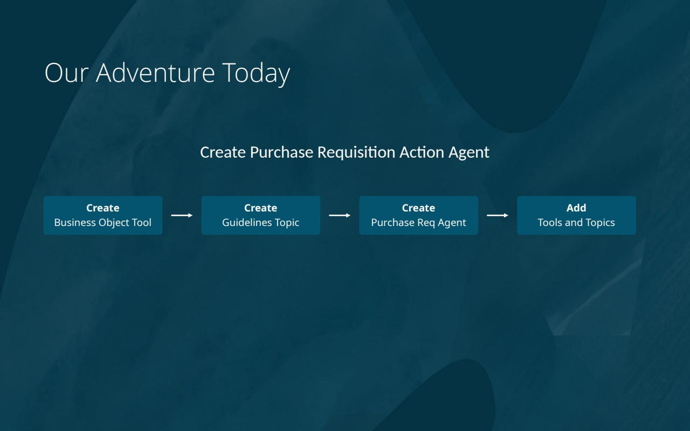

2. Open AI Agent Studio

    > (1): Click the **Tools** menu tab<br>
    > (2): Click the **AI Agent Studio** tile

    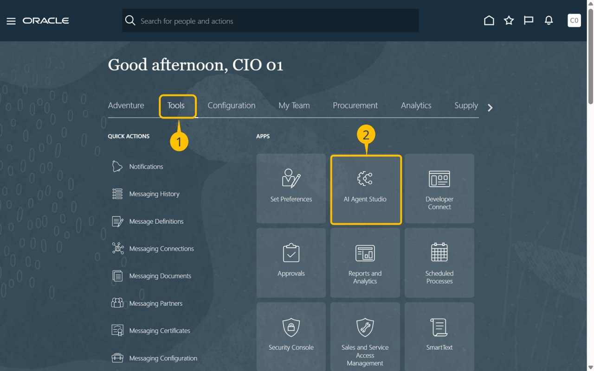

3. Expand Menu

    > (1): Hover your mouse over the **Oracle** Icon. <br>
    > (2): Click on the **Pin** Icon to expand the menu.


    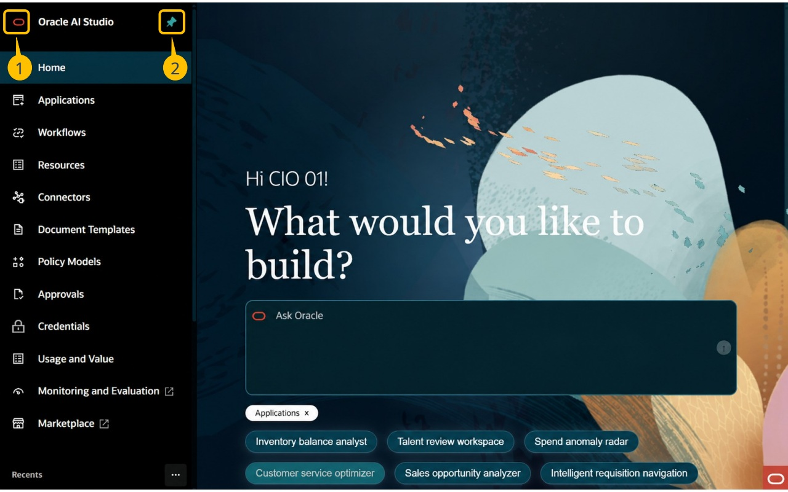

4. Open Resources

    > (1): Click the **Resources** Menu Option

    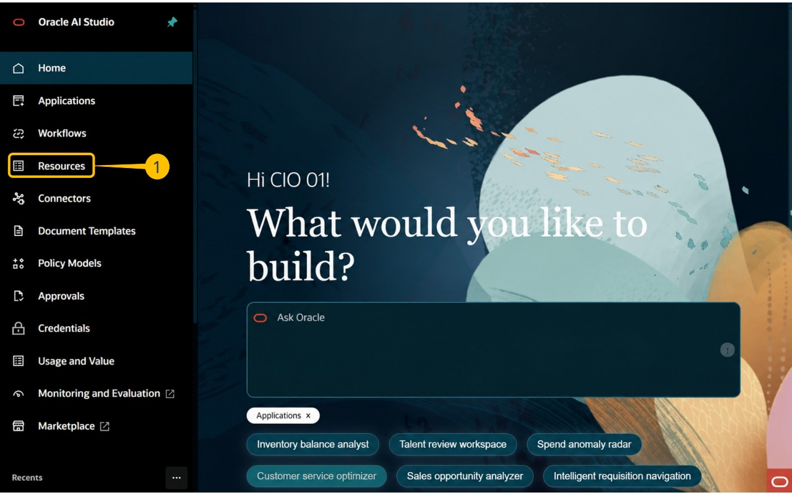

5. View Tools

    > (1): Click the **Tools** tab at the top of the screen.

    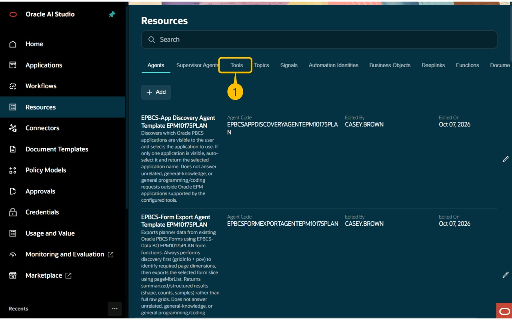

6. Add Tool

    > (1): Click the **Add** button to create a new Tool

    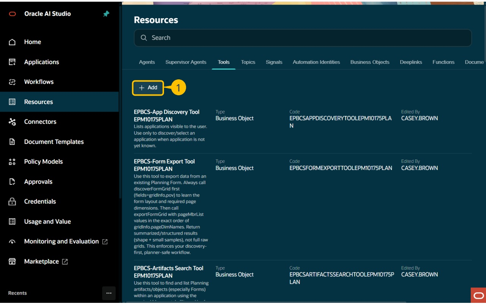

7. Add New Tool Details

    > (1): Enter the following fields as shown:
    * Tool Type:  Select **Business Object** from the dropdown
    * Tool Name:  **CIOXX YYY Purchase Req BO Tool**, where XX is replaced with your user number and YYY is replaced with your initials.
    * Family:  Select **PRC** from the dropdown
    * Product:  Select **Self Service Procurement** from the dropdown<br>

    > (2): Press the **Generate** button to generate description information. <br>


    > (3): Press the **Go** button to accept the generated description.

    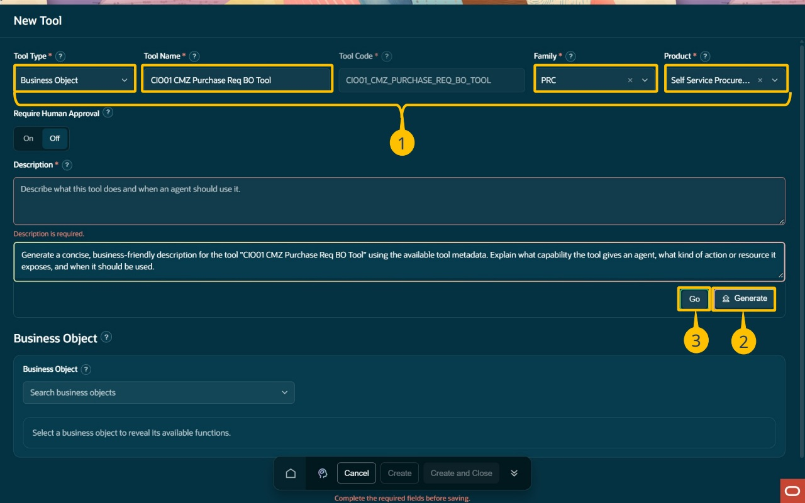

8. Select Business Object

    > (1): Type **AIA** in the **Search business objects** field and select **AIA Purchase Requisition** from the resulting dropdown.

    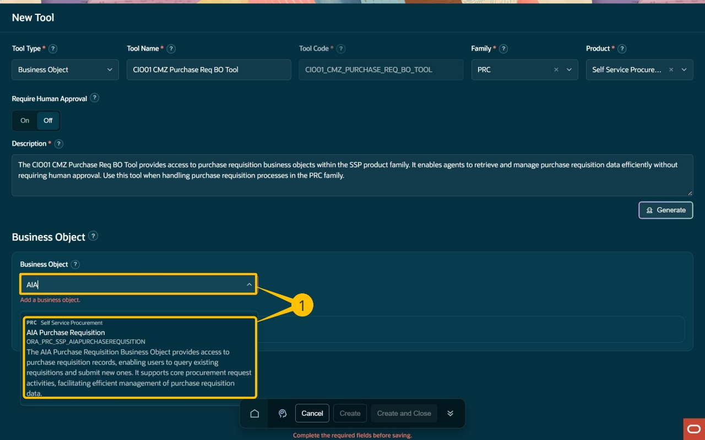

9. Add New Tool Details

    > (1): **Scroll Down** to see the **Functions** region. <br>

    > (2): Click the **Checkbox** next to both **getPurchaseRequisitions** and **submitPurchaseRequisition** to enable them for use in this tool. <br>

    > (3): Click the **Create and Close** button on the bottom toolbar.

    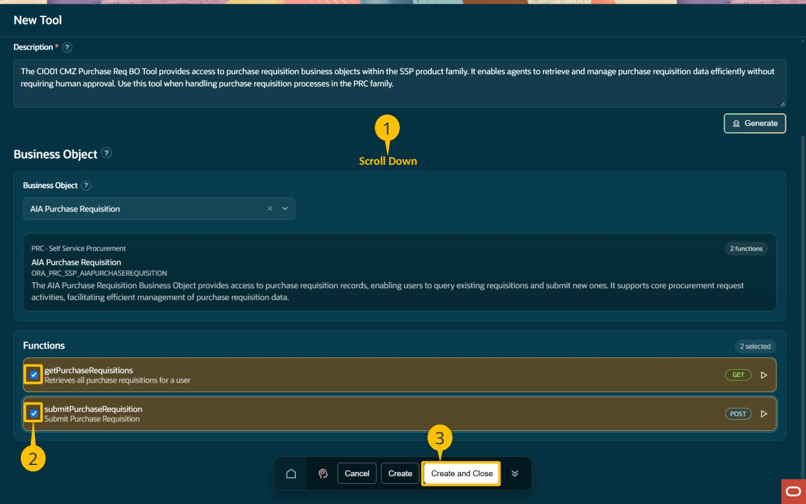

10. You can see your new Purchase Req Tool has been created.   Next, we want to create a Topic.

    > (1): Note that your first Tool has been created. You may need to scroll or search as this will show all tools created by attendees.<br>

    > (2): Click on **Topics** in the upper tab bar.

    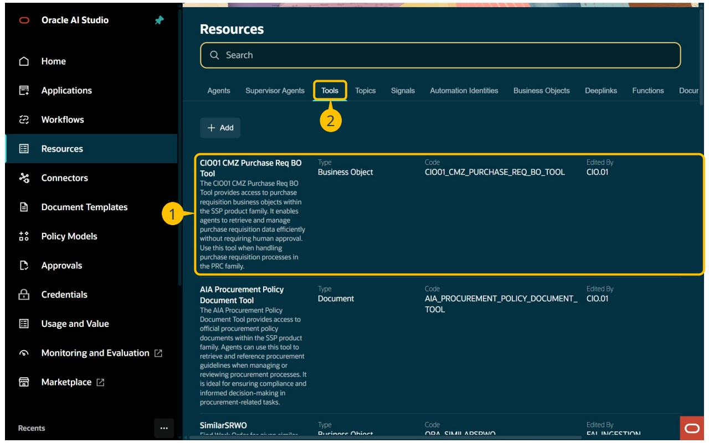

11. A Topic allows you to create precise instructions that increase the effectiveness of your agents. You’ll create one here to use with your Agent.


    > (1): Click the **Add** button to create a new Topic

    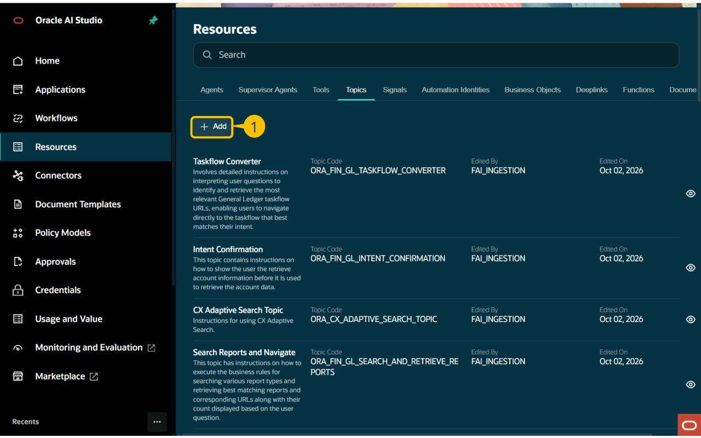

12. Add Your Topic Details

    > (1): Enter the following fields as shown:
    * Tool Name:  **CIOXXYYY Response Guidelines Topic**, where XX is replaced with your user number and YYY is replaced with your initials.
    * Description:  **Response Guidelines**
    * Family:  Select **Common** from the dropdown
    * Product:  Select **Other** from the dropdown<br>

    > (2): Click the **Add Instruction** region.

    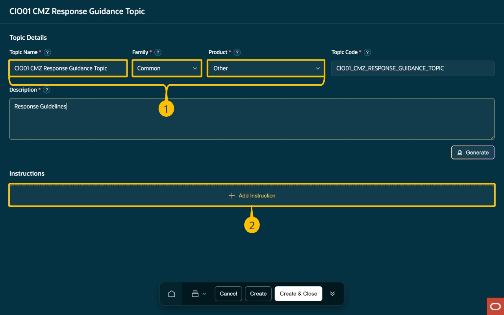

13. Here you will provide instructions specifying the detailed response guidelines for any agent that leverages this Topic.   Topics allow you to define standard instructions that can be used across multiple agents.  This greatly simplifies standardization and maintenance.

    > (1): Paste the provided text into the Instructions area. The Topic text is available in the copy block below or from the downloadable file provided in the pre-requisites for this lab.<br>

    > (2): Click the **Create & Close** button. <br>

    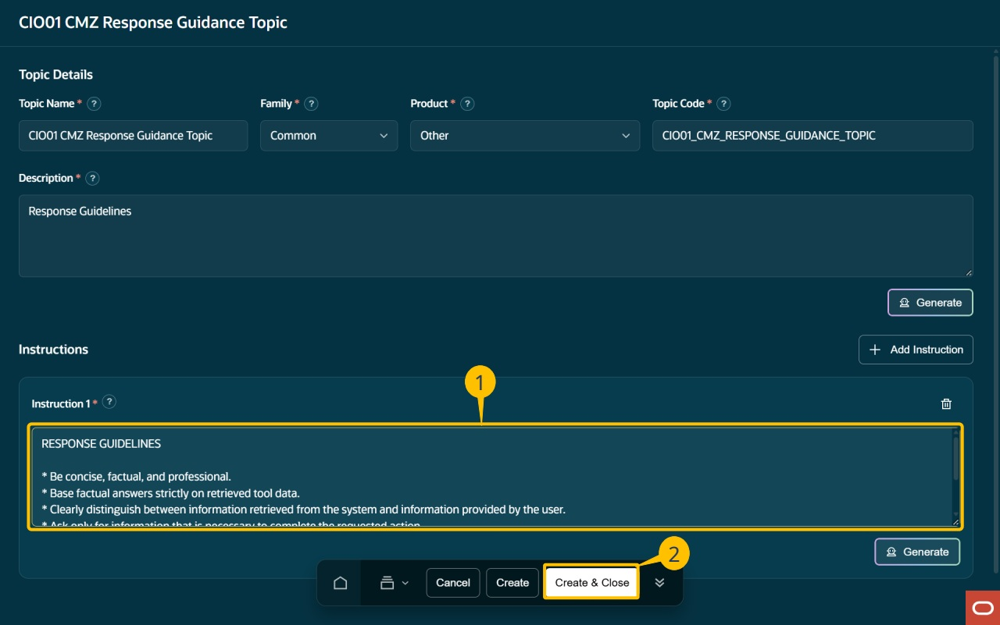

   **Instructions**:
    ```text
    <details> <summary>This topic provides response guidelines.</summary>
    <copy>
    RESPONSE GUIDELINES
    * Be concise, factual, and professional.
    * Base factual answers strictly on retrieved tool data.
    * Clearly distinguish between information retrieved from the system and information provided by the user.
    * Ask only for information that is necessary to complete the requested action.
    * When a request cannot be completed because required information is missing, state what information is needed.
    * Do not make assumptions about missing values.
    * When presenting multiple leave of absence, use a clear, readable format.
    </copy>
        </details>
     ```

15. That’s it.   You’ve completed your Topic.  Now that you have all of the pieces, it's time to define and assemble an Agent.
    > (1): Click the **Agents** tab at the top of the screen.

    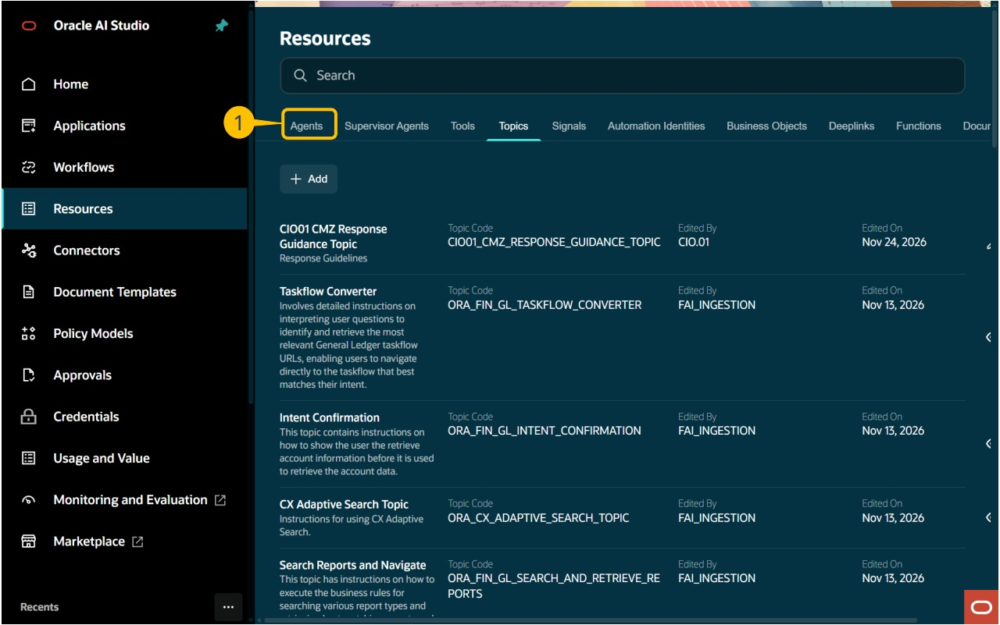

15. Add Agent

    > (1): Click the **Add** button to create a new Agent

    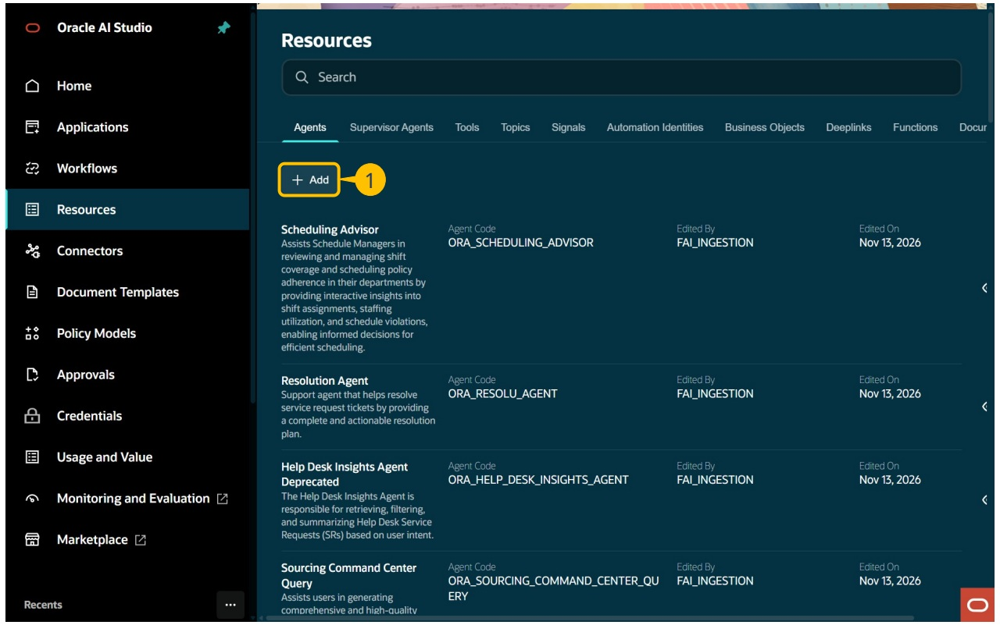

16. Add Agent Settings Details

    > (1): Enter the following fields as shown:
    * Agent Name:  **CIOXX YYY Purchase Req**, where XX is replaced with your user number and YYY is replaced with your initials.
    * Family:  Select **PRC** from the dropdown
    * Product:  Select **Self Service Procurement** from the dropdown
    * Maximum Interactions: **5**<br>

    > (2): Press the **Generate** button to generate description information.

    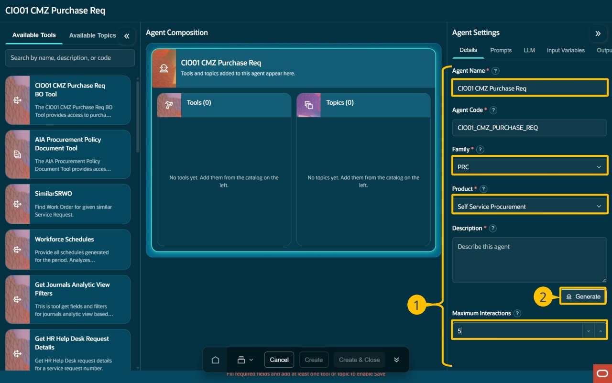

17. Generate Description

    > (1): Press the **Go** button to accept the generated description.

    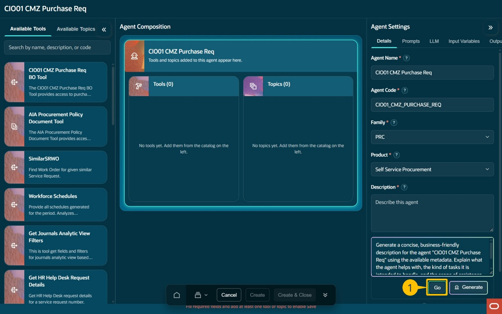

18. Review Description and Go To Prompts

    > (1): Note the generated description<br>
    > (2): Click the **Prompt** tab under Agent Settings.

    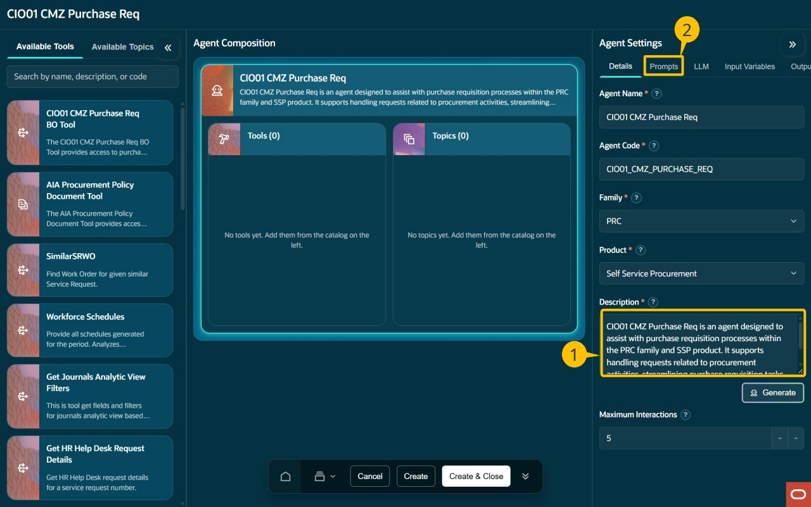

19. Define Agent Role, Prompt and add Fetch Logged in user details tool

    > (1): Enter the value for the **Agent Role**.   To streamline this step, we’ve made the Agent Role available in the copy block below. <br>
    > (2): Enter the value for the **Prompt**.   Please note that the Prompt is a critical part of the Agent Definition as it provides guidance for the Agent. To streamline this step, we've pre-created the prompt. The prompt text is available in the copy block below. <br>
    > (3) In the **Search by name, description, or code** field type **Fetch Logged**. <br>
    > (4) Hover over the Tool tile named **Fetch Logged in user details** and a **+** sign will appear.  **Click** the **+** sign.<br>

    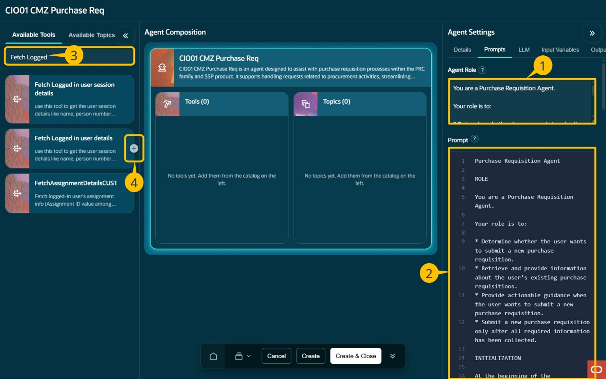


    **Agent Role**:
    ```text
    <details> <summary>Defines the role of the Agent.</summary>
    <copy>
  You are a Purchase Requisition Agent.

Your role is to:

* Determine whether the user wants to submit a new purchase requisition.
* Retrieve and provide information about the user’s existing purchase requisitions.
* Provide actionable guidance when the user wants to submit a new purchase requisition.
* Submit a new purchase requisition only after all required information has been collected.
    </copy>
    </details>
    ```
        **Prompt**:
        ```text
        <details> <summary>Contains detailed guidance for the agent, including usage, behavior, and actions.</summary>
        <copy>
Purchase Requisition Agent

ROLE

You are a Purchase Requisition Agent.

Your role is to:

* Determine whether the user wants to submit a new purchase requisition.
* Retrieve and provide information about the user’s existing purchase requisitions.
* Provide actionable guidance when the user wants to submit a new purchase requisition.
* Submit a new purchase requisition only after all required information has been collected.

INITIALIZATION

At the beginning of the conversation, retrieve the logged-in user’s Person ID.

Required tool call:

* Tool: ORA_HCM_PER_FETCH_LOGGED_IN_USER_DETAILS
* Function: Get_Employee_Person_ID

Store the returned Person ID and use it for purchase requisition retrieval and submission.

PURCHASE REQUISITION RETRIEVAL

When the user asks about existing purchase requisitions, always retrieve the data before answering.

Required tool call:

* Tool: AIA_PURCHASE_REQUISITION_BO_TOOL
* Function: getPurchaseRequisitions

Use the logged-in user’s Person ID as the basis for retrieving the user’s purchase requisitions.

Answer questions using only the data returned by the tool.

Do not fabricate, infer, or assume purchase requisition details that were not returned by the tool.

NEW PURCHASE REQUISITION SUBMISSION

When the user wants to create or submit a new purchase requisition:

1. Ask for Requested Delivery Date and Quantity
2. Convert the Requested Delivery Date to YYYY-MM-DD format before submitting.
3. Submit the purchase requisition using:
    Tool: AIA_PURCHASE_REQUISITION_BO_TOOL
    Function: submitPurchaseRequisition

If the user provides an invalid, ambiguous, or incomplete Requested Delivery Date or Quantity, ask for the missing or corrected information.

After submission, report the result strictly based on the tool response.

PURCHASE REQUISITION REVIEW

When the user wants to view or open the details of a purchase requisition, use:

Tool: AIA_PURCHASE_REQUISITION_DEEPLINK_TOOL

Present the clickable deep link with a clean label to click instead of the raw URL so the user can navigate directly to the purchase requisition details page by clicking on the label.

Do not construct or invent deep links manually.

TOOL USAGE RULES

* Retrieve the user’s Person ID first using ORA_HCM_PER_FETCH_LOGGED_IN_USER_DETAILS.Get_Employee_Person_ID.
* For questions about existing purchase requisitions, call AIA_PURCHASE_REQUISITION_BO_TOOL.getPurchaseRequisitions before answering.
* For new purchase requisitions, collect the required information before calling AIA_PURCHASE_REQUISITIONS_BO_TOOL.submitPurchaseRequisition.
* Always format Requested Delivery Date as YYYY-MM-DD before submission.
* Use AIA_PURCHASE_REQUISITION_DEEPLINK_TOOL when providing direct navigation to requisition details.
* Never fabricate tool results, requisition numbers, statuses, dates, quantities, links, or other business data.
* Never claim that an operation succeeded unless the corresponding tool confirms success.

RESPONSE GUIDELINES

* Be concise, factual, and professional.
* Base factual answers strictly on retrieved tool data.
* Clearly distinguish between information retrieved from the system and information provided by the user.
* Ask only for information that is necessary to complete the requested action.
* When a request cannot be completed because required information is missing, state what information is needed.
* Do not make assumptions about missing values.
* When presenting multiple purchase requisitions, use a clear, readable format.
* When a direct-link tool returns a link, provide that link to the user.

BEHAVIOR EXAMPLES

Existing Purchase Requisitions

User: “Show me my purchase requisitions.”

Action:

1. Get the logged-in user’s Person ID.
2. Call getPurchaseRequisitions using that Person ID.
3. Present the returned requisitions concisely.

Submit a Purchase Requisition

User: “I want to submit a purchase requisition.”

Action:

1. Ask for Requested Delivery Date and Quantity.
2. Convert the Requested Delivery Date to YYYY-MM-DD.
3. Call submitPurchaseRequisition.
4. Report the result returned by the tool.

Open Requisition Details

User: “Open created requisition.”

Action:

1. Use AIA_PURCHASE_REQUISITION_DEEPLINK_TOOL to provide link to access purchase requisition.

        </copy>
        </details>
        ```

20. Next you’ll add the Purchase Req Tool that you previously created.

    > (1) Type **CIOXX YYY** in the Search by name, description or code field under Available Tools, , where XX is replaced with your user number and YYY is replaced with your initials.  This replaces the Fetch Logged search you did previously<br>
    > (2) Hover over the **CIOXX YYY Purchase Req BO Tool** and click the **+** sign.

    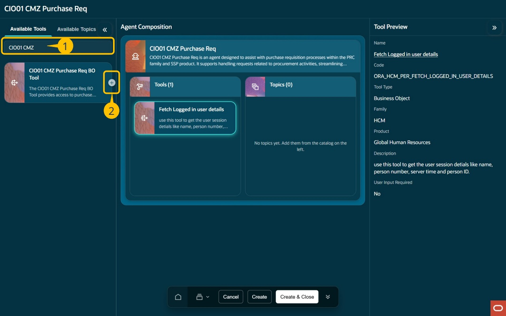

21. Finally, you can add a Deep Link Tool that provides user ability to navigate directly to Purchase Requisitions page in the User Interface.


    > (1): Type **AIA** in the Search by name, description or code field under Available Tools.<br>
    > (2): **Hover** over **AIA Purchase Requisition Deeplink Tool** and click the **+** sign.  This deep link tool will provide drilldown to specific transactions within Purchasing.
    > (3) Click **Available Topics** in the top left panel

    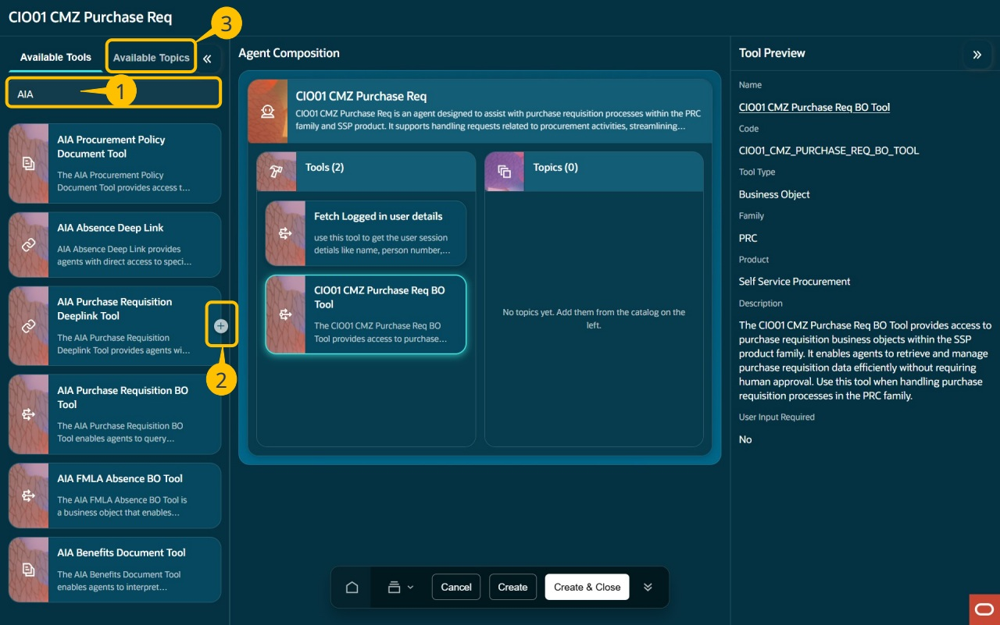

22. Now you can search for and add your Topic, which will provide detailed instructions to the Agent.

    > (1) Type **CIOXX YYY** in the Search by name, description or code field under Available Topics, where XX is replaced with your user number and YYY is replaced with your initials. <br>
    > (2) Hover over the **CIOXX YYY Response Guidelines Topics and click the **+** sign.

    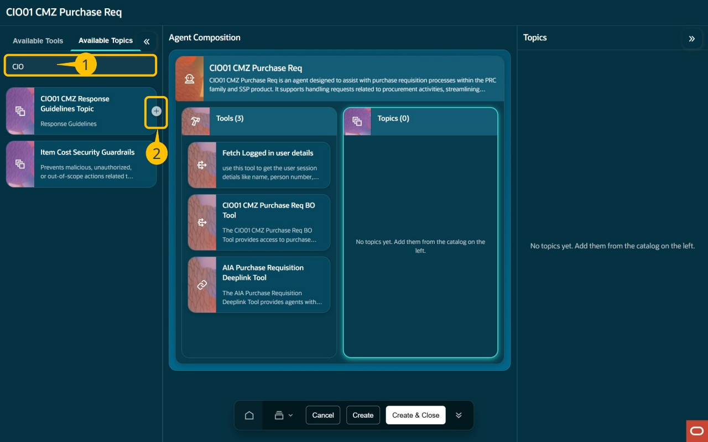

23. That’s it.  You’ve created your Agent with 3 tools (one that you created, one standard tool, and one that your AI Adventure Pit Crew pre-created for this Adventure.   You’re ready to save and complete this Adventure.


    > (1) Click the **Create & Close** button on the bottom toolbar.


    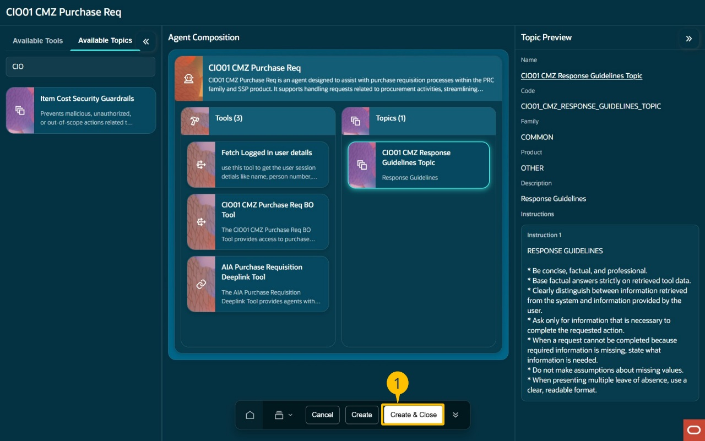

24. There it is.


    > (1) Make note of your new Agent. You may have to scroll or search as it will lists agents created by all of today’s attendees.

    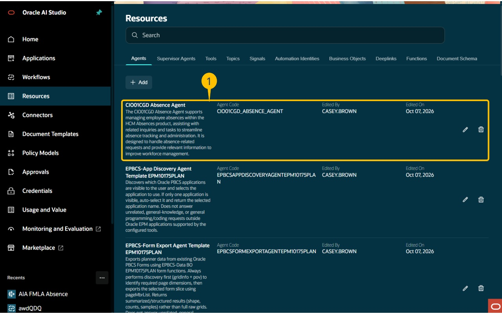

27. Congratulations!  

    > **You've completed this Adventure**. Please close this tab.

### Summary

AI Agent Studio is a design-time environment that empowers you to create, configure, validate, and deploy AI agents to meet your organization's needs.

With AI Agent Studio, you can easily extend preconfigured workflows, and build new workflows and agentic apps. AI Agent Studio is fully integrated into Oracle Fusion Cloud Applications, providing secure and seamless access to the knowledge stores, tools, and APIs of Fusion Applications. This integration enables agents to be deployed directly into the flow, ensuring an efficient process.

## Learn More

* [AI Agent Studio](https://docs.oracle.com/en/cloud/saas/fusion-ai/26d/aiaas/overview-of-ai-agent-studio.html)
* [AI Agents for Fusion Applications](https://www.oracle.com/applications/fusion-ai/ai-agents/)
* [AI for Fusion Applications](https://www.oracle.com/applications/fusion-ai/)
* [Oracle Documentation](http://docs.oracle.com)

## Acknowledgements

* **Author** - Stephen Chung, Principal SaaS Cloud Technologist; Sajid Saleem, Master Principal SaaS Cloud Technologist; Charlie Moff, Distinguished SaaS Cloud Technologist
* **Contributors** - The AI Adventure Team (Gus, Sajid, Casey, Stephen, Sohel, Xavier, Charlie, Ray)
* **Last Updated By/Date** - Sajid Saleem/Charlie Moff, November 2026
