# Assemble and Test an AI Workflow using AI Agent Studio

### Introduction

AI Agent Studio for Fusion Applications is a comprehensive platform for creating, extending, deploying and managing AI Agents and Agent Teams across the enterprise. Oracle AI Agent Studio delivers easy-to-use tools, including advanced testing, robust validation, and built-in security, that helps Oracle Fusion Applications customers and partners create and manage AI agents. Leveraging the same technology that Oracle uses to create AI agents, Oracle AI Agent Studio enables users to easily extend pre-packaged agents and/or create new agents and then deploy and manage them.

### Objectives

In this activity you will use Oracle Fusion AI Agent Studio to
* Assemble an Workflow Agent using LLM, Switch and Agent Nodes.  
* The Workflow will determine user intent and use the appropriate agent to provide a response.
* It will utilized a predefined Benefits Policy Agent (RAG) to answer questions about available benefits.
* It will also use the FMLA Absence Agent created in the preceding lab.
* You will then test the Agent Workflow using the included Debug feature of AI Agent Studio by inquiring about benefits, checking for existing absences, and having the agent create an absence request.

Estimated Time: 15 minutes

## Predefined Copy Blocks


****Please Note**** This adventure requires the entry of a User Prompt and an Output Specification. To streamline typing and eliminate any typing errors, these are shown in-line in the guide below and also available in the copy blocks below.<br><br>
**User Prompt**:
```text
<details> <summary>Instructs the LLM node how to determine if user intent is policy or absence/leave related.</summary>
<copy>
    Based on the user’s message in {{$context.$system.$inputMessage}}, identify the user’s primary intent.

    If the user asks about available employee benefits, set userIntent to Policy.

    If the user requests one of the following
    - Query for existing absences OR FMLA absences
    - Query for existing leaves OR FMLA leaves
    - Create a new absence
    - Create a new leave
    Set userIntent to Leave.

    Return only the userIntent value.
</copy>
</details>
```
**Output Specification**:
```text
<details> <summary>Details the JSON Schema for the output.</summary>
<copy>
{
  "$schema": "http://json-schema.org/draft-04/schema#",
  "type": "object",
  "properties": {
    "userIntent": {
      "type": "string"
    }
  }
}
</copy>
</details>
```
**Builder Assistant Prompt**:
```text
<details> <summary>Prompts the Builder Assistant to Add a Node.</summary>
<copy>
Add email node and connect to Benefits Policy Advisor. Input for the email node should be the output response from Benefits Policy Advisor to send notification email with the response
</copy>
</details>
```

## Begin Adventure

1. Build a Workflow Agent


    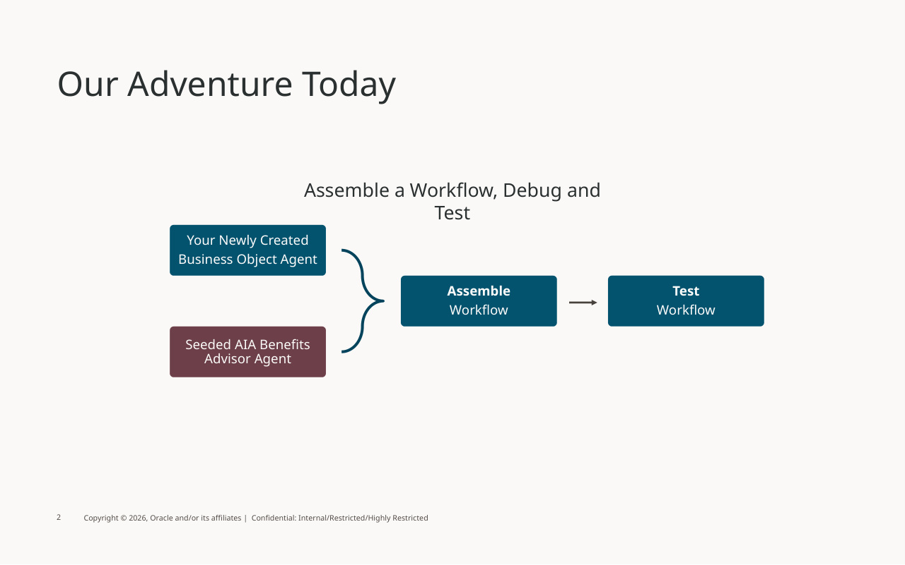

2. Open AI Agent Studio

    > (1) Click the **Tools** menu tab<br>
    > (2) Click the **AI Agent Studio** tile

    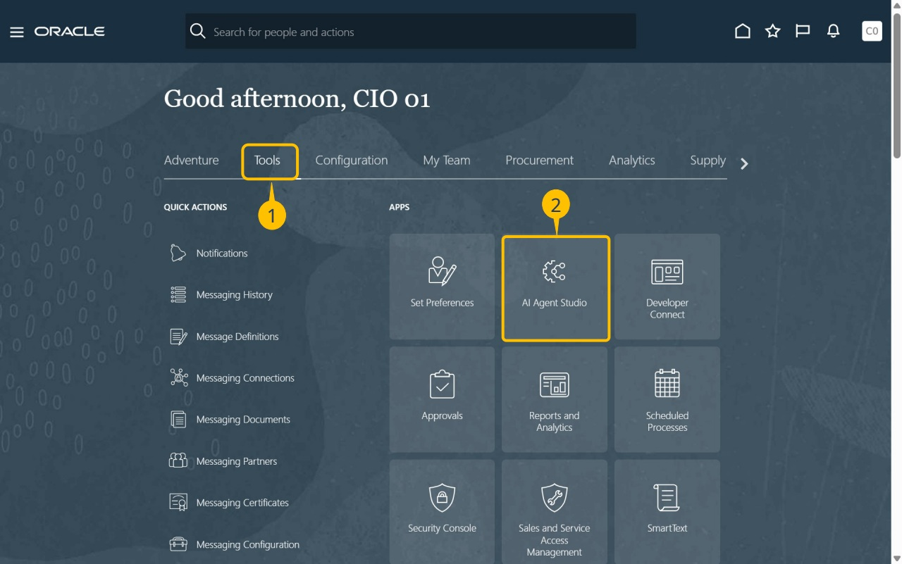

3. Expand Menu

    > (1): Hover your mouse over the **Oracle** Icon. <br>.
    > (2): Click on the **Pin** Icon to expand the menu.

    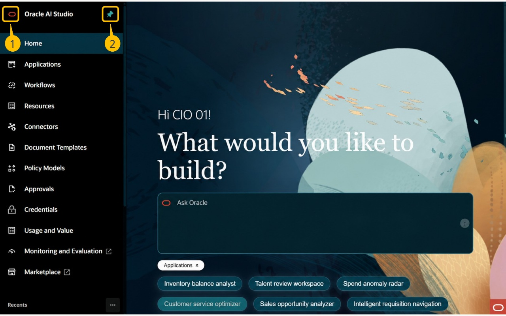

4. Open Workflows

    > (1) Click the **Workflows** Menu Option

    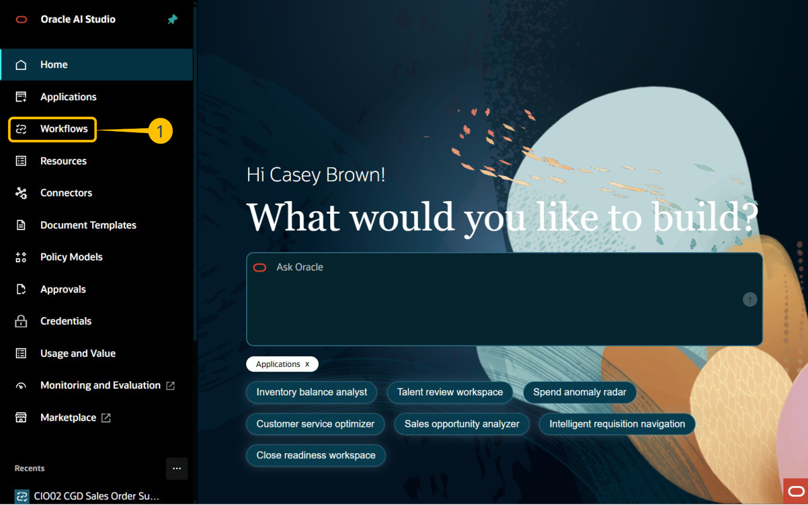

5. You’ll now create a workflow that leverages the Agent that you previously created. 

    > (1) Click the **Add** button to create a new Workflow

    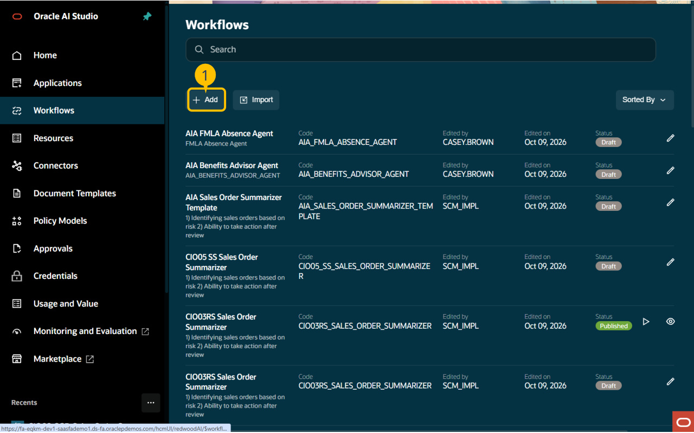

6. Workflow Settings: Details

    > (1) Enter the following fields as shown:
    * Agent Team Name:  **CIOXXYYY Benefits Workflow** where XX is your user number and YYY is your initials. 
    * Family:  **HCM**
    * Benefits:  **Benefits**
    * Description:  **Benefits and FMLA Workflow**<br>


    > (2) Click on **Create**

    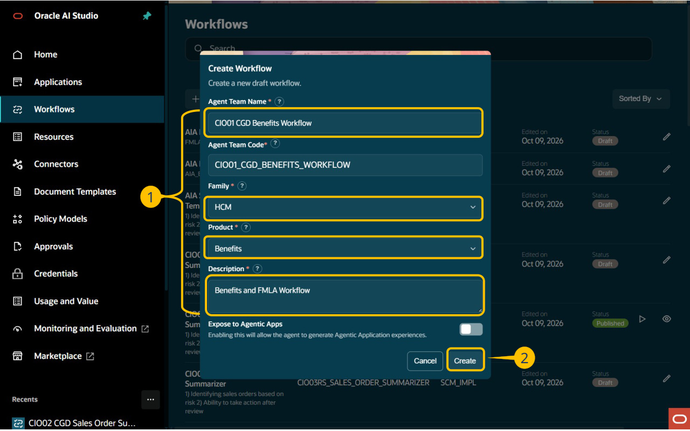

7. Workflows can include a lot of components including data components, logic, workflow controls, human approval, loops, switches, code nodes and much more.  You can see these in the Component Palette

    > (1) If you don't see the Component Palette on the left side of the screen, click the  **Show Component Palette** in the bottom toolbar

    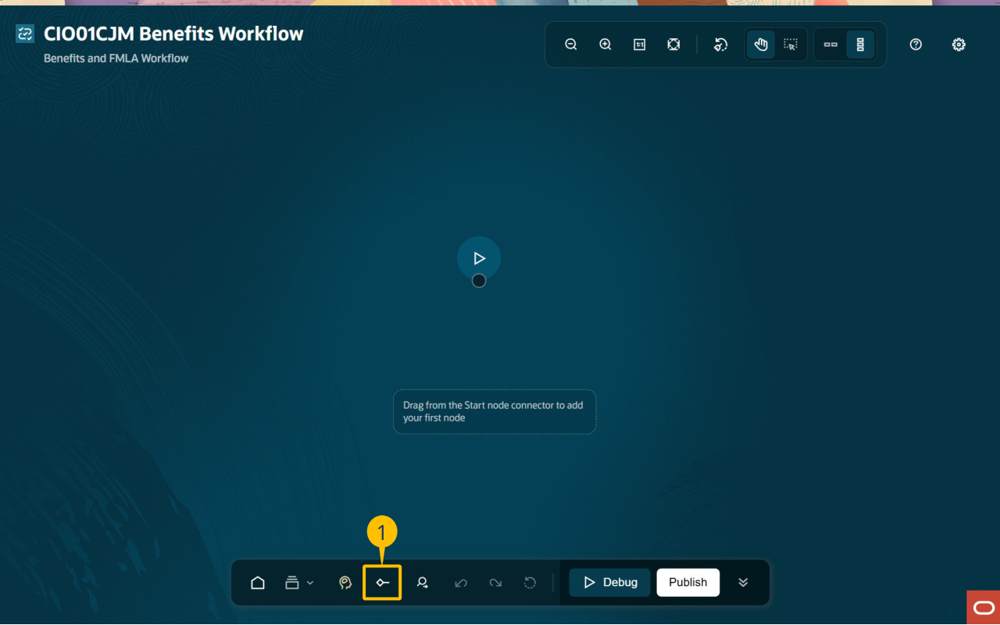

8. You can Click and Drag to add nodes to your workflow. 


    > (1) Click the  **Black Circle Icon** under the play icon and drag to the **Dotted Rectangle** region below it.<br>
    > (2) Release the mouse once in the drag is complete.

    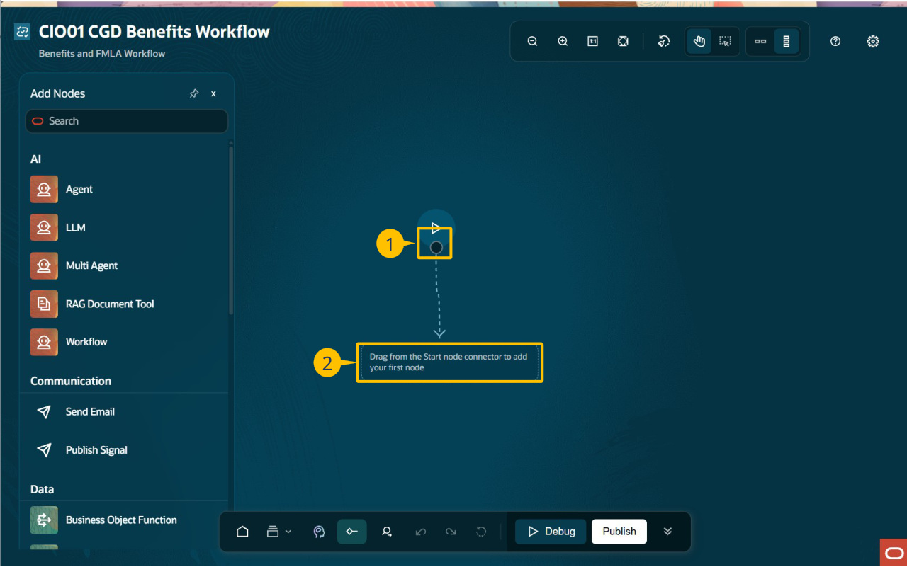

9. Your first step will call an LLM to get User Intent

    > (1) Select  **LLM** from the dropdown list

    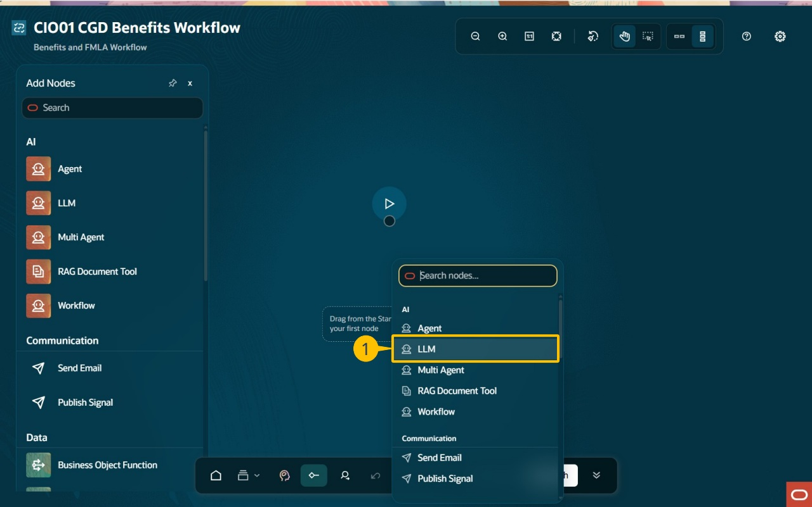

10. Enter Basic Information about this node.

    > (1) Type **Get Intent** in the Name field<br>
    > (2) **Scroll Down**

    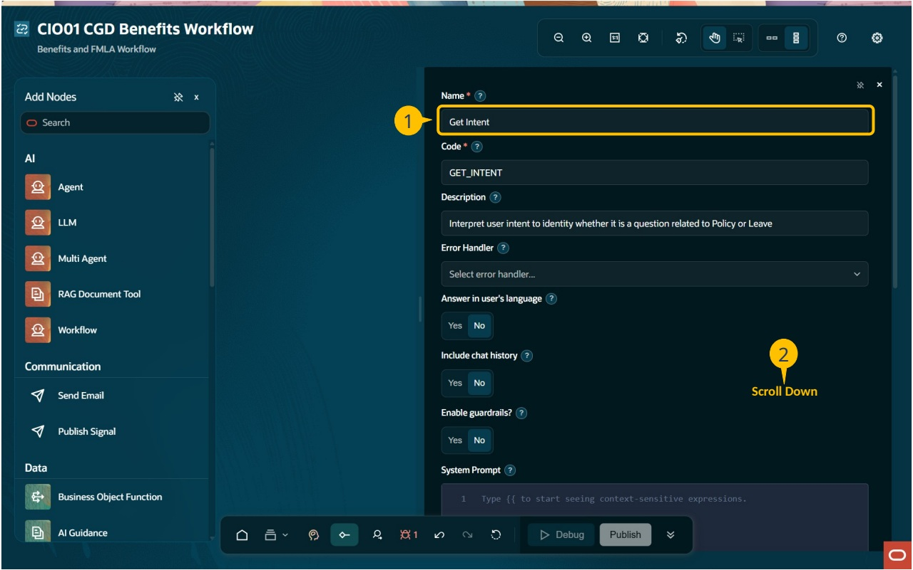


11. Here you’ll enter the prompt information for this node.  You want the workflow to determine whether the user is asking a query about benefit policies or trying to work with absences and leaves.

    > (1) Enter the **User Prompt**.  To streamline this step, we've pre-created the prompt. The prompt text is available in the copy block below.<br>
 ****Make sure you paste into the User Prompt field and not the System Prompt****<br> 

    > (2) Enter the **Output Specification**.  To streamline this step, we've pre-created the output specification. The output specification text is available in the copy block below.<br>

    > (3) Click the **x** icon in the top right corner of the Agent panel to close the panel.  Your work is always auto-saving.


    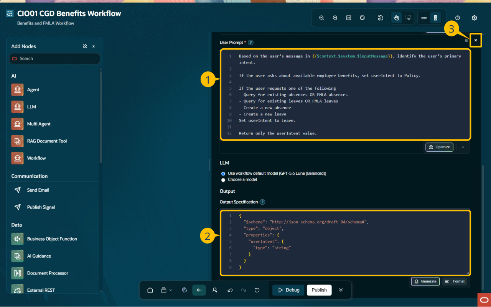
        **User Prompt**:
        ``` text
        <details> <summary>Instructs the LLM node how to determine if user intent is policy or absence/leave related.</summary>
        <copy>
        Based on the user’s message in {{$context.$system.$inputMessage}}, identify the user’s primary intent.

        If the user asks about available employee benefits, set userIntent to Policy.

        If the user requests one of the following
        - Query for existing absences OR FMLA absences
        - Query for existing leaves OR FMLA leaves
        - Create a new absence
        - Create a new leave 
        Set userIntent to Leave.

        Return only the userIntent value.
        </copy>
        </details>
        ```
        **Output Specification**:
        ```text
        <details> <summary>Details the JSON Schema for the output.</summary>
        <copy>
        {
        "$schema": "http://json-schema.org/draft-04/schema#",
        "type": "object",
        "properties": {
            "userIntent": {
            "type": "string"
            }
        }
        }
        </copy>
        </details>
        ```

12. Your next node will be a Switch.  This will enable the workflow to determine to appropriate route for this request.

    > (1) Click the  **Black Circle Icon** at the bottom of your newly created Get User Intent node and drag to the **open space** in the box below.<br>
    > (2) Release the mouse once in the drag is complete.

    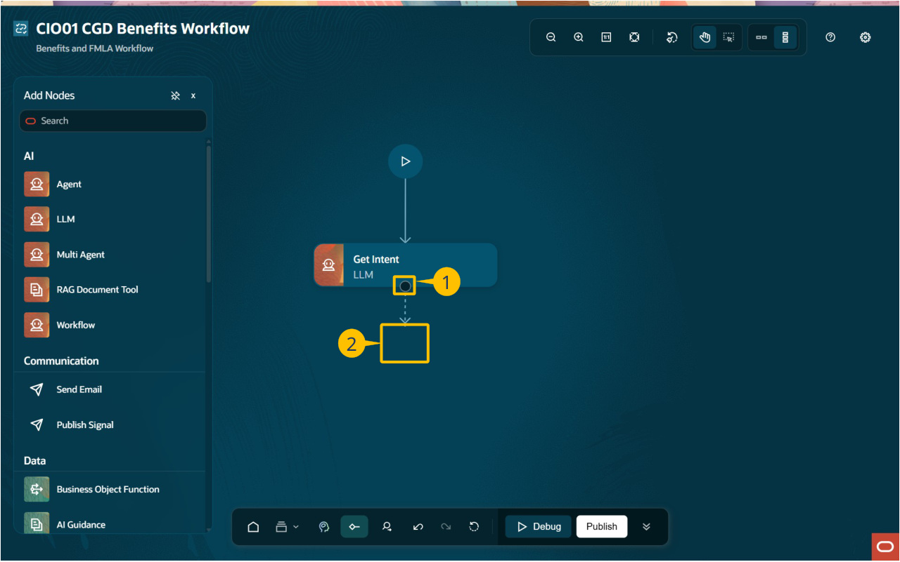

13. You will select the Switch node. 

    > (1) Select  **Switch** from the list of available nodes.  You can scroll to find it or use the Search nodes filter at the top of the list.

    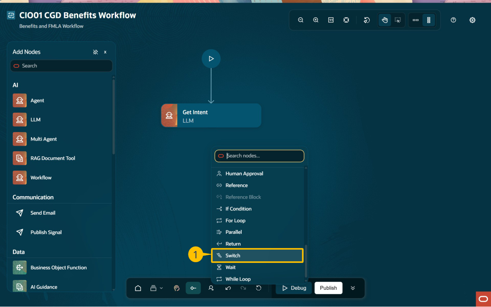

14. The Switch node allows you to define the criteria for routing this request.  After naming the node, you will use the dropdown (popup) box to enter the desired Case Expression.

    > (1) Enter **Route based on Intent** in the Name field. <br>
    > (2) Click the **dropdown** icon on the end of the Case Expression field<br>
    > (3) Select **Nodes** from the list of available options

    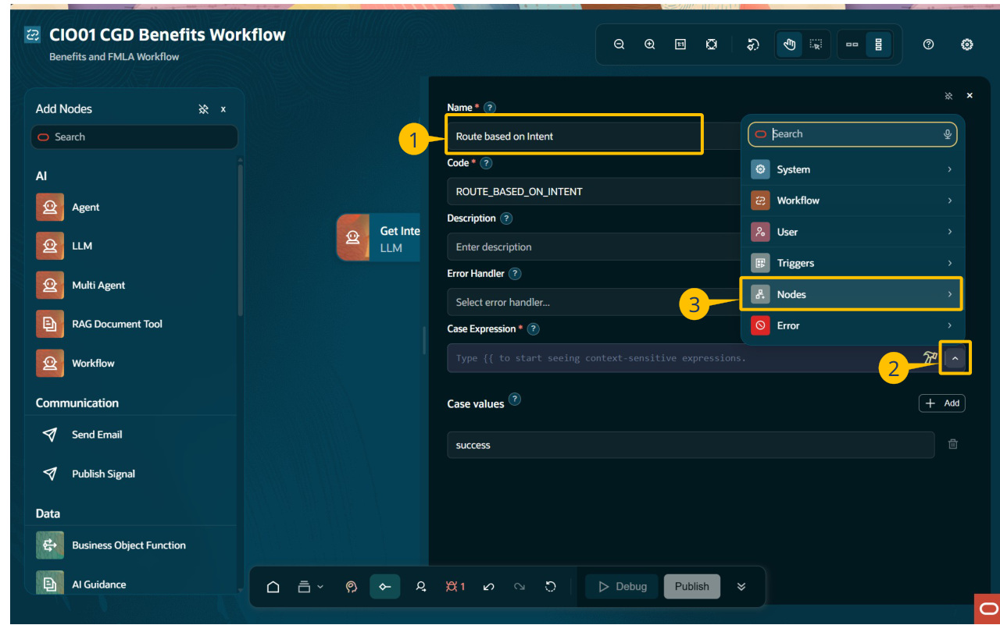

15. There’s only one option here, so you can select it.

    > (1) Select **Get Intent** from the list.  There’s only a few more clicks to go.

    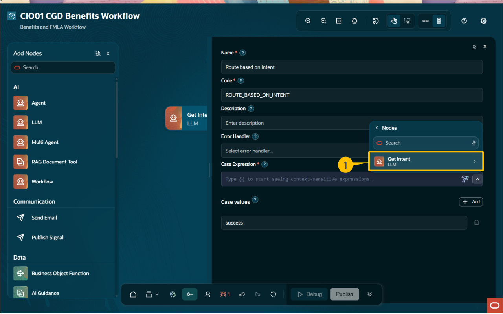

16. There are a few options here.  We want to use the Output from the Get Intent node.  Notice that there are other options as well, including Error handling.

    > (1) Select **Output** from the list.  One more click to go after this.

    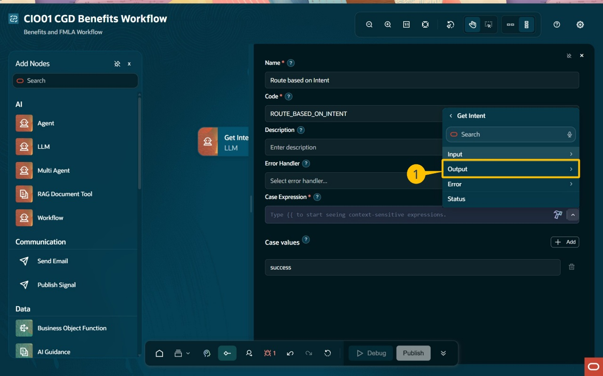

17. userIntent is the only option and it’s what you want.  That will allow the workflow to route properly based on the logic in the following steps.

    > (1) Select **userIntent** from the list.  

    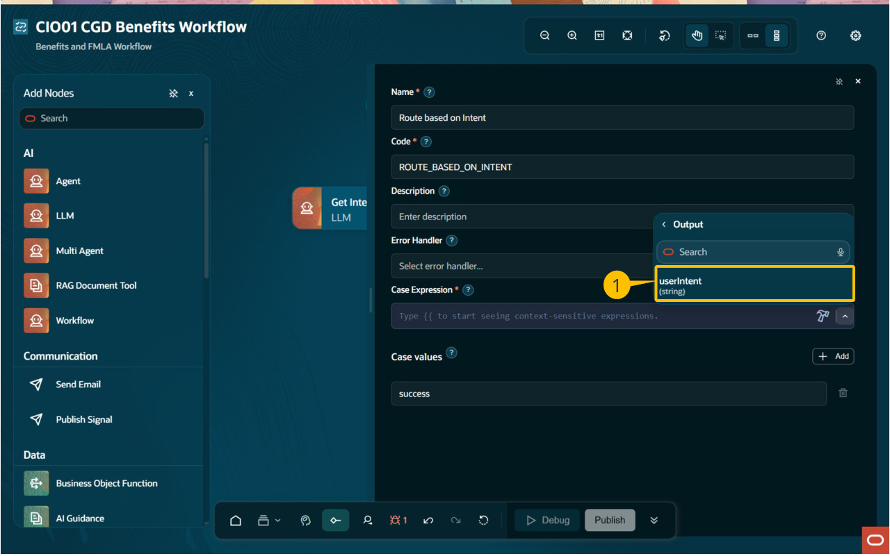

18. You’ve defined the Case Expression.  Now, you’ll review it and enter the case values.

    > (1) Note that you now have a value in the **Case Expression** field.  Alternatively, you could have entered this expression directly.  But, where’s the fun in that.  Plus, the dropdowns help you understand your options and get the syntax correct. <br>
    > (2) You may need to **Scroll down** to see the Case values.

    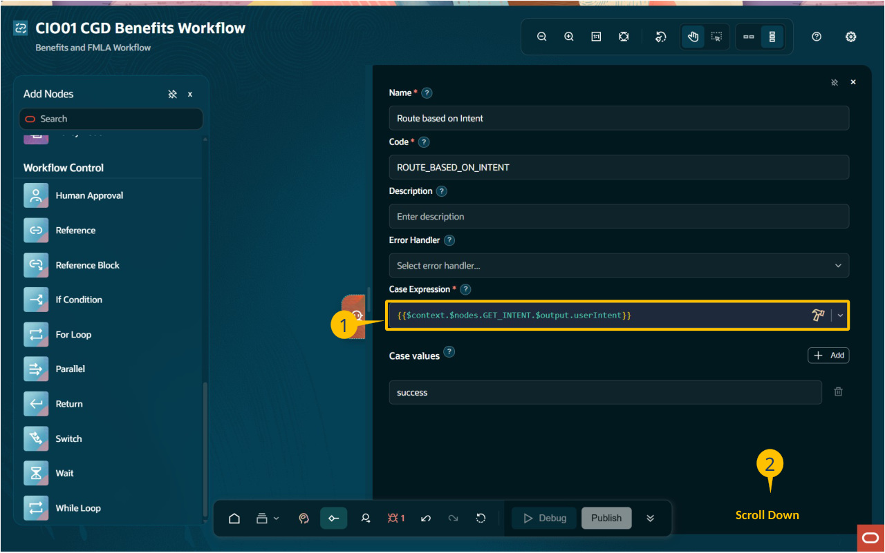

19. You want to Case values based on the possible outcomes from your User Intent Node

    > (1) **Replace** the word Success in the Case value field with **Policy**<br>
    > (2) Click the **+ Add** button to allow you to enter another value. <br>
    > (3) Enter **Leave** for the 2nd case value field. <br>
    > (4) Click the **x** icon in the top right corner of the Agent panel to close the panel.  Your work is always auto-saving.


    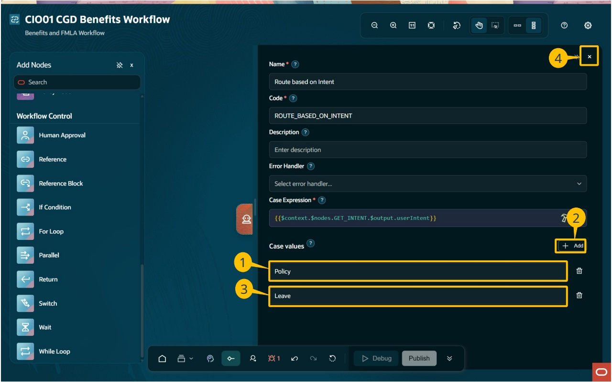

20. Next, you’ll add Agents for the two possible Switch Outcomes (Policy and Leave).  If you’re finding your Workflow layout a little unwieldy, you can also Click-and-Drag to rearrange the nodes.

    > (1) **Hover** over **Route based on intent** switch node to see the optional routes.<br>
    > (2) Click and Drag from the **Policy** black circle icon to the **open space** below.<br>
    > (3) Release the mouse once in the drag is complete.

    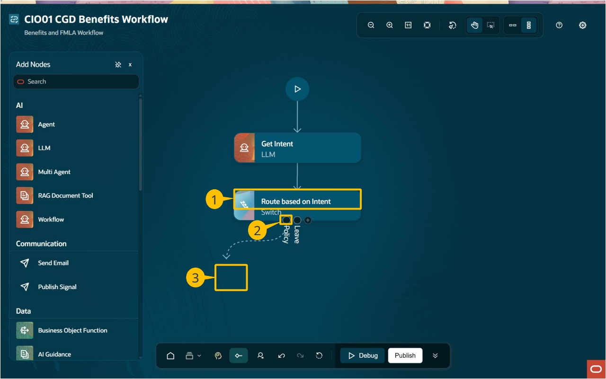

21. For the Policy option, you’ll want the Workflow to call the seeded AIA Benefits Agent.  So, this route will call an Agent.

    > (1) Select **Agent** from the resulting dropdown. 

    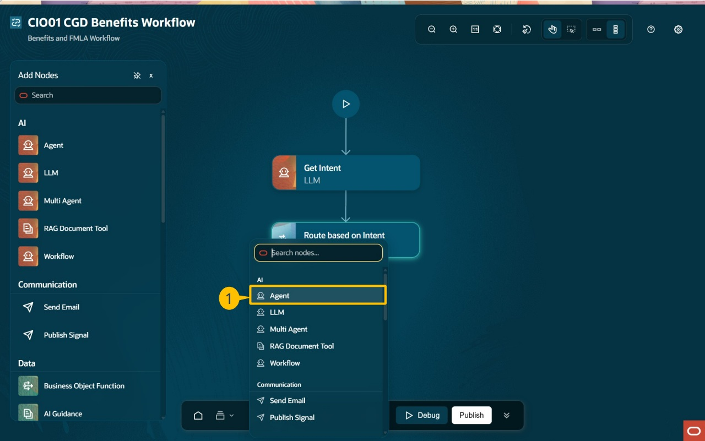

22. You can name this node and specify the Agent that it calls.

    > (1) Enter **Benefits Advisor Agent** in the Name field. <br>
    > (2) **Scroll down** to specify the Agent.

    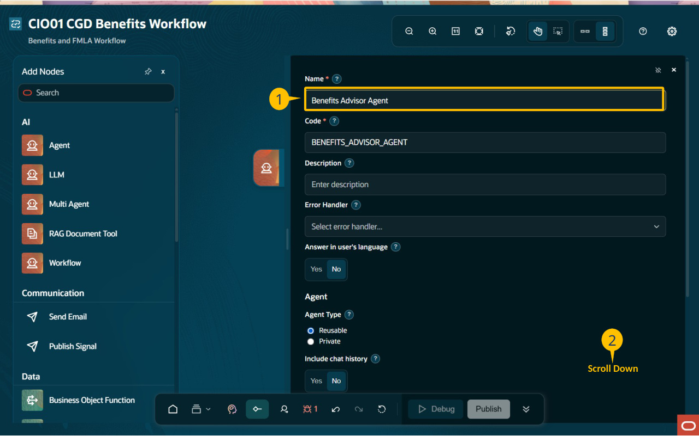

23. Specify that this node will use the AIA Benefits Advisor Agent.


    > (1) Type **AIA** and select **AIA Benefits Advisor Agent** from the resulting dropdown.  Note how Family and Product auto populates based on the agent you selected.<br>

    > (2) Click the **Down Arrow**  &#8964; icon on the bottom right of the **Message** field

    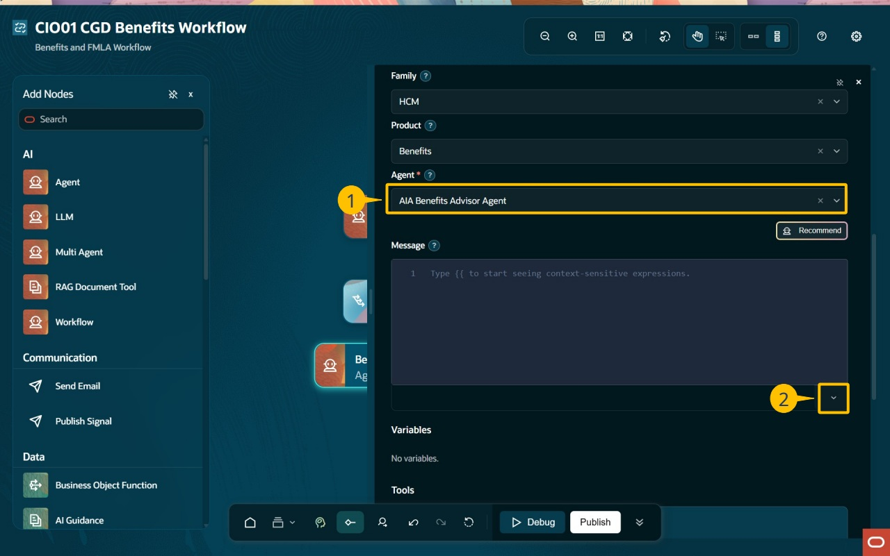

24. You need to specify the value of the message field.  To do that, you’ll set the message field to the inputMessage.  If you know the proper syntax you can just enter it.   Alternatively, and what you’ll do here is use the drop down to select it from the system of available variables


    > (1) Click **System** from the resulting dropdown menu.

    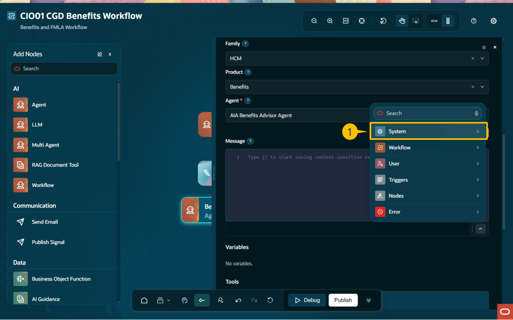

25. Now you just select the Input Message.


    > (1) Click **Input Message** from the resulting dropdown menu.

    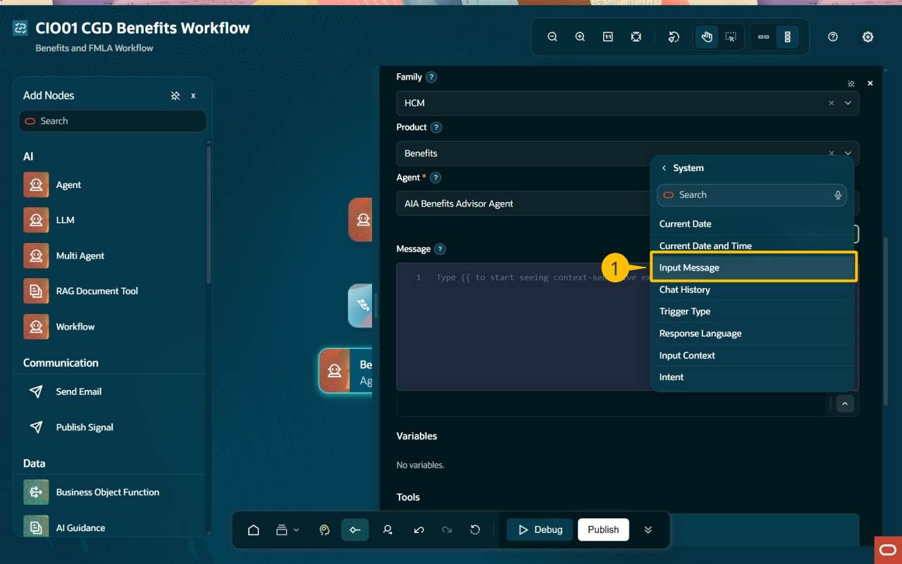

26. You can confirm the message and close the Agent panel


    > (1) Confirm that **{{$context.$system.$inputMessage}}** has been properly defined in the Message field.<br>

    > (2) Click the **x** icon in the top right corner of the Agent panel.

    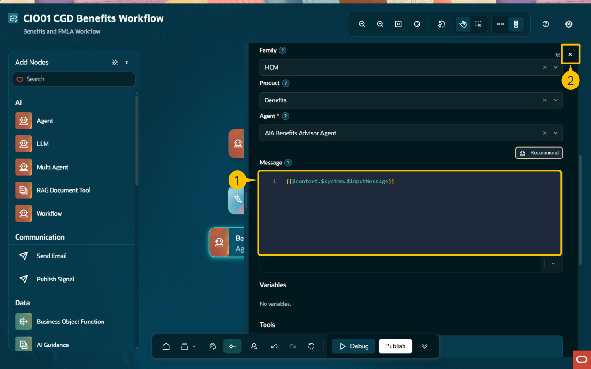

27. You’ve already specified the routing for one of the output options, so now it’s time for you to specify the routing for Leave

    > (1) **Hover** over **Route based on intent** switch node to see the optional routes.<br>
    > (2) Click and Drag from the **Leave** black circle icon to the **open space** below.<br>
    > (3) Release the mouse once in the drag is complete.

    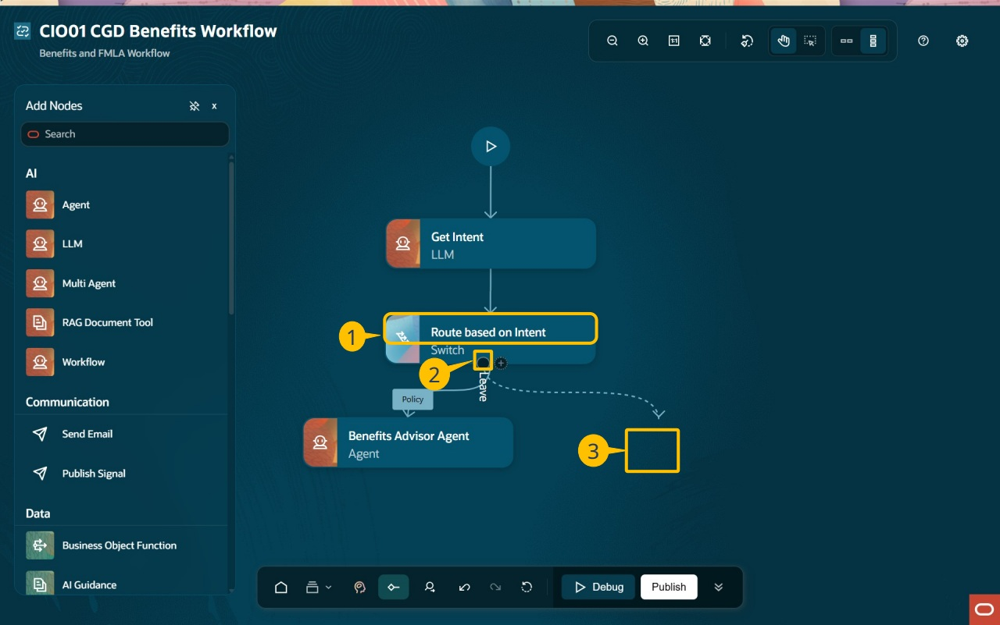

28. For the Leave option, you’ll want the Workflow to call the Business Object agent that you created in the previous lab.  So, this route will also call an Agent.

    > (1) Select **Agent** from the resulting dropdown. 

    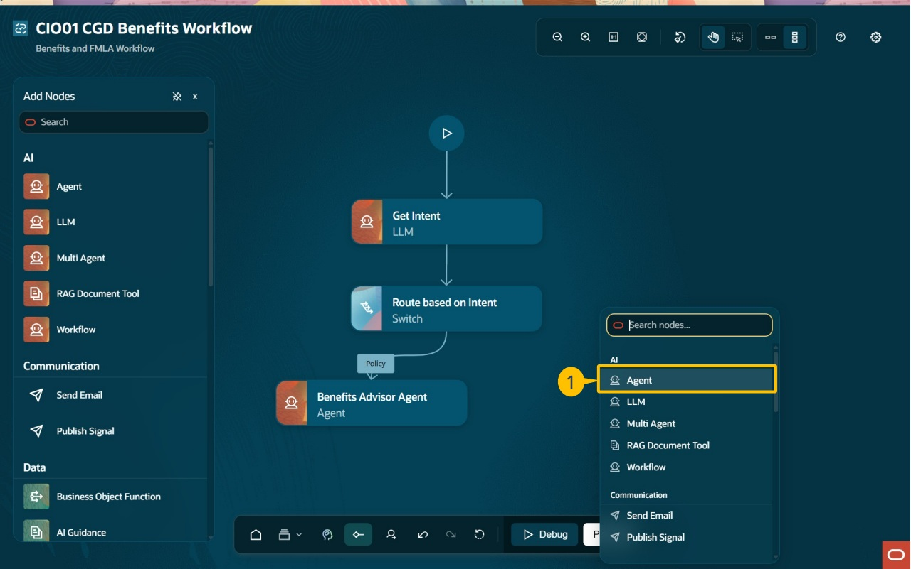

29. You can probably see where this is headed.  You now need to name the Node and select the Agent to be called for this route.

    > (1) Enter **Leave and Absence Agent** in the Name field. <br>
    > (2) **Scroll down** to specify the Agent.

    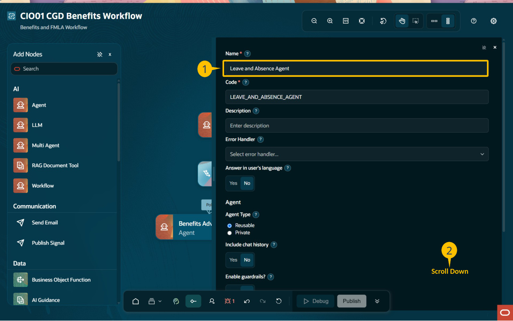

30. Specify that this node will use your CIOXXYYY Absence Agent from the previous lab.


    > (1) Type **CIOXXYYY** and select **CIOXXYYY Absence Agent** from the resulting dropdown.  Remember, XX is your user number and YYY is your initials.  Seriously, you should be used to that by now.<br>

    > (2) Type **{{$context.$system.$inputMessage}}** in the Message field.   Alternatively, click the **Dropdown** box under the **Message Field** and select **System** and then **Input Message** like you did previously.<br>

    > (3) Click the **x** icon in the top right corner of the Agent panel.

    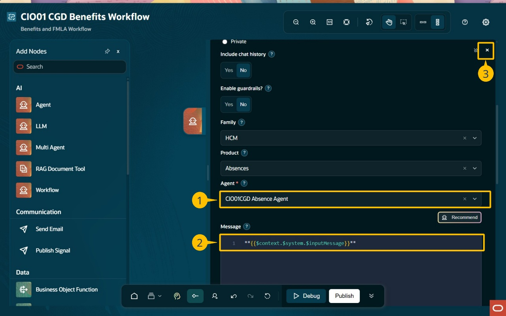

31. Before you start testing you can take a few seconds to pretty up your workflow layout.  We don’t need Pit Crew members tripping over things.<br>

    > (1) Optionally click the **Prettify** icon on the top toolbar to clean-up and/or redd up the layout.<br>
    > (2) Optionally click the **Zoom to Fit** icon on the top toolbar to make sure everything fits on your screen.  I know, we should’ve told you this earlier.<br>
    > (3) Optionally click and drag to reposition your visualization.  You can click individual items or click near the top to drag the whole diagram.<br>
    > (4) Click on the **Debug** button on the bottom toolbar to test your agent 

    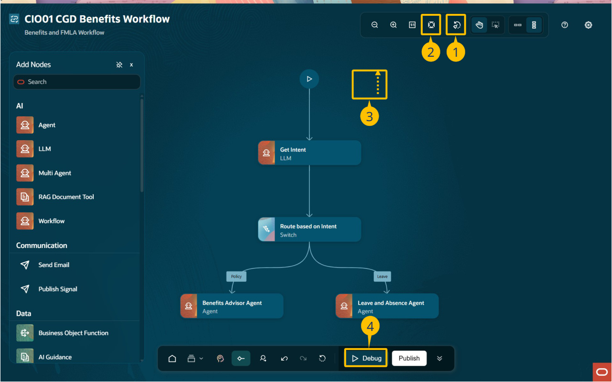

32. Begin the conversation with your Benefits Agent Workflow.  Depending on your screen resolution and magnification you may want to Prettify and Zoom to Fit again.

    > (1) Optionally click the **Prettify** icon on the top toolbar to clean-up and/or redd up the layout.<br>
    > (2) Optionally click the **Zoom to Fit** icon on the top toolbar to make sure everything fits on your screen.  I know, we should’ve told you this earlier.<br>
    > (3) Enter **Please Summarize my available benefits** into the chat window and hit the **Enter** key.

    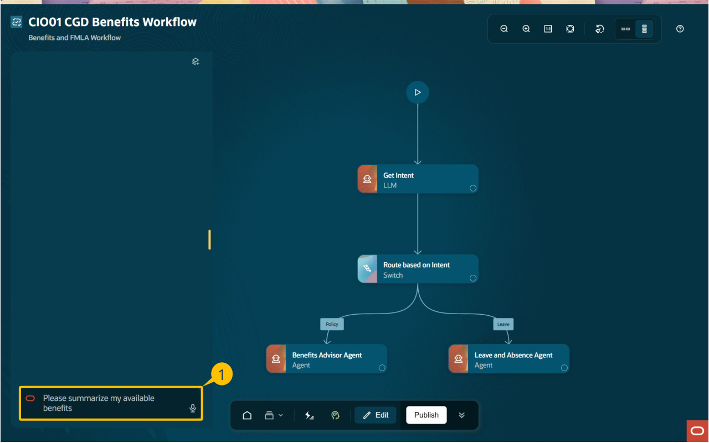

33. Explain Debug and Continue your conversation with the agent workflow

    > (1) Note the response to your question.  Scroll the response window, if necessary.<br>
    > (2) Note that the diagram has highlighted (in green) the path that the Agent Workflow used to respond to the question. <br>
    > (3) Click the **Benefits Advisor Agent** box to show the results information panel

    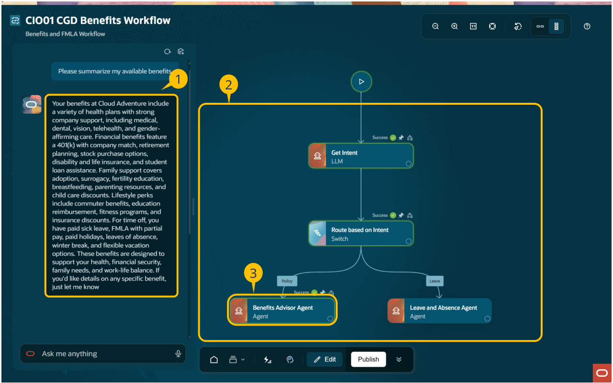

34. Explain Debug and Continue Conversation.

    > (1) Note the Results and Configuration tab on the pop-up panel.  This shows details about the agent execution. <br>
    > (2) Click the **x** icon on the top right of the pop-out panel<br>
    > (3) Type **do I have fmla benefits** in the **Ask me anything** box on the bottom left and press the **Enter** key.

    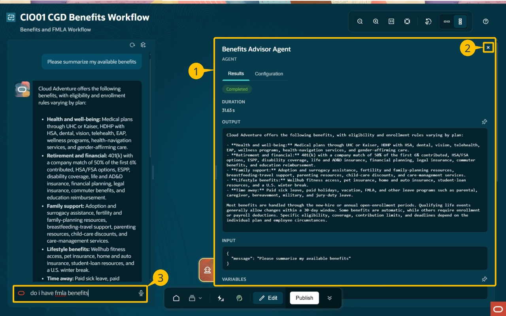

35. Continued Debug Discussion

    > (1) Note the response to your question.  Scroll the response window, if necessary. <br>
    > (2) Type **Do I have any existing FMLA absences** in the **Ask me anything** box on the bottom left and press the **Enter** key.

    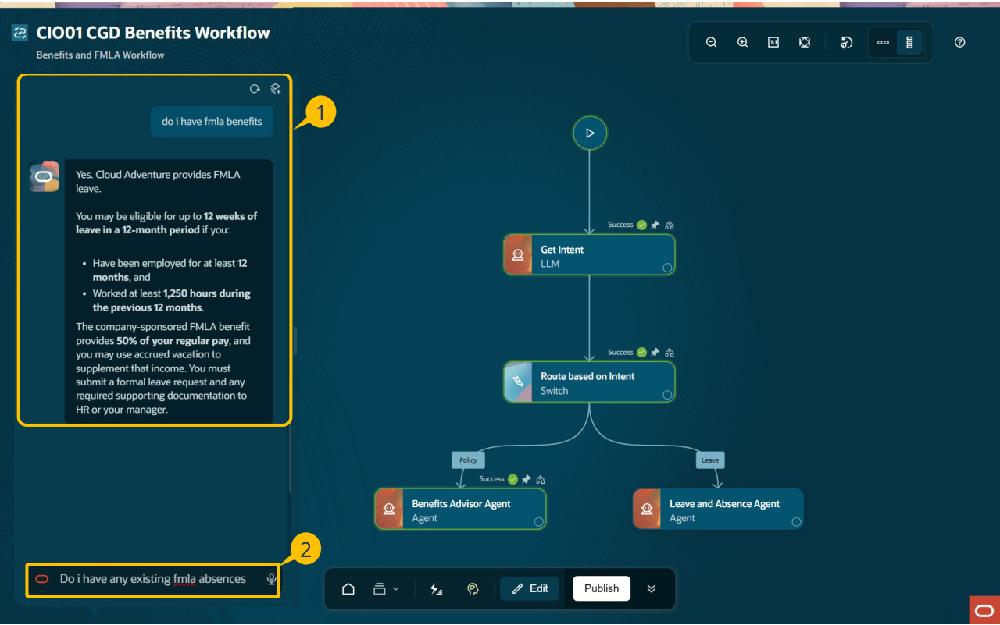

36. Get Absence Response and Ask to Create one.  Note that the Workflow took a different route since it needs to query HCM Cloud to determine the response instead of providing responses based on policy documents.

    > (1) Note the response to your question.  Scroll the response window, if necessary.  It will show you whether you have any existing absences.  Your individual response may vary.<br>
    > (2) Type **Please create a new FMLA leave** in the **Ask me anything** box on the bottom left and press the **Enter** key.

    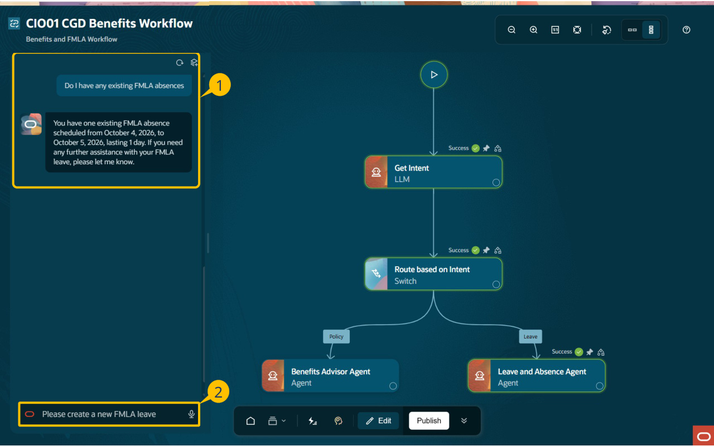

37. The Agent wants to create your FMLA absence requests, but requires additional information.  In this case, the date range of the leave.

    > (1) Note that the agent has asked for start and end dates for your requested FMLA leave<br>
    > (2) Type **Start Date of 11/2/26 and end date of 11/4/26** in the **Ask me anything** box on the bottom left and press the **Enter** key.  Feel free to select other dates for your start and end dates

    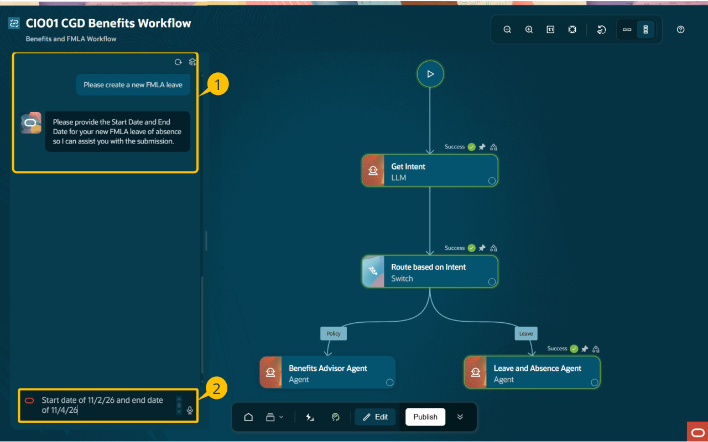

38. Success!  The agent has created my new FMLA leave request and confirms both the new request and the previously existing one.  Maybe you’d like to see it in HCM.


    > (1) Note the response about the newly created FMLA leave request.<br>
    > (2) Type **Show me link to last created absence** in the **Ask me anything** box on the bottom left and press the **Enter** key. 

    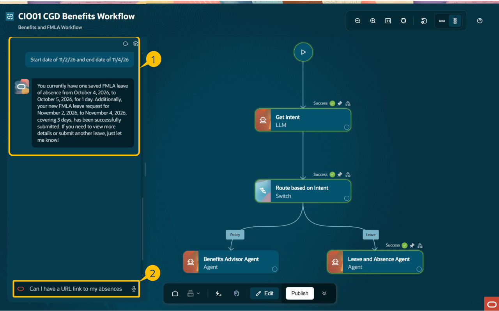

39. You can use the link to drill directly to your absences in HCM Cloud.


    > (1) Click the **View your existing absences** link.

    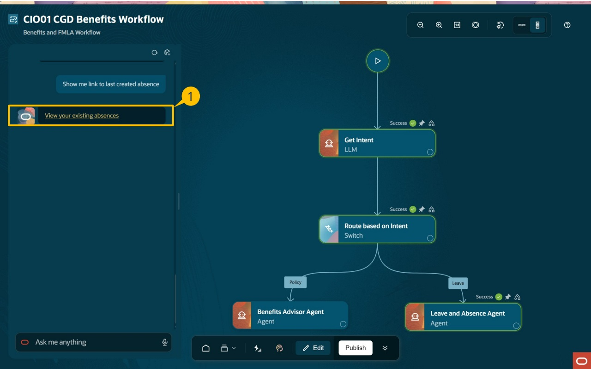

40. Here’s your absences

    > (1) Note your newly created absence. <br>
    > (2) After reviewing, **Close this tab** to return to your AI Agent Studio tab.

    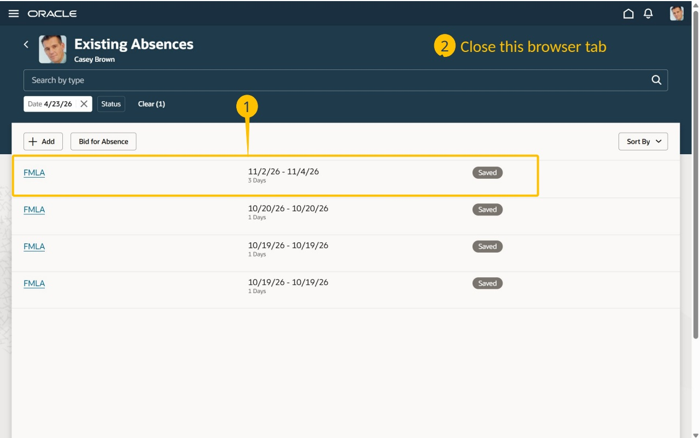

 ****Note that you have completed the planned portion of this adventure.  This next section is optional.  You can review and/or do these steps if time permits. It demonstrates two new features, the Builder Assistant and an Email Notification Node.  To skip this section, go to Step 55****

41. Back in AI Agent Studio, now.  If you have the time, we have a **Bonus** section of the Adventure that allows you to experience the Builder Assistant feature.


    > (1) Click the **Edit** button in the bottom toolbar.  This will allow you to begin editing your workflow again.<br>
    > (2) Click the **Zoom to Fit** in the upper toolbar to straighten your workflow diagram.

    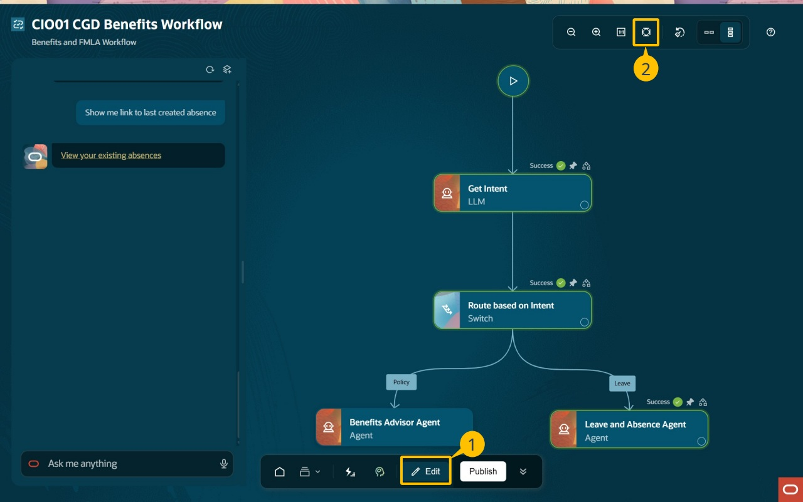

42. Use the Builder Assistant to get an overview of the workflow capabilities.  This is especially helpful when editing an Oracle provided or previously created workflow


    > (1) Click the **Builder Assistant** icon in the bottom toolbar.  It’s the one that looks like a person’s head and it will show **Toggle Chat Popup** when you hover over it.<br>
    > (2) Select **Explain what this workflow does** from the resulting popup chat window.

    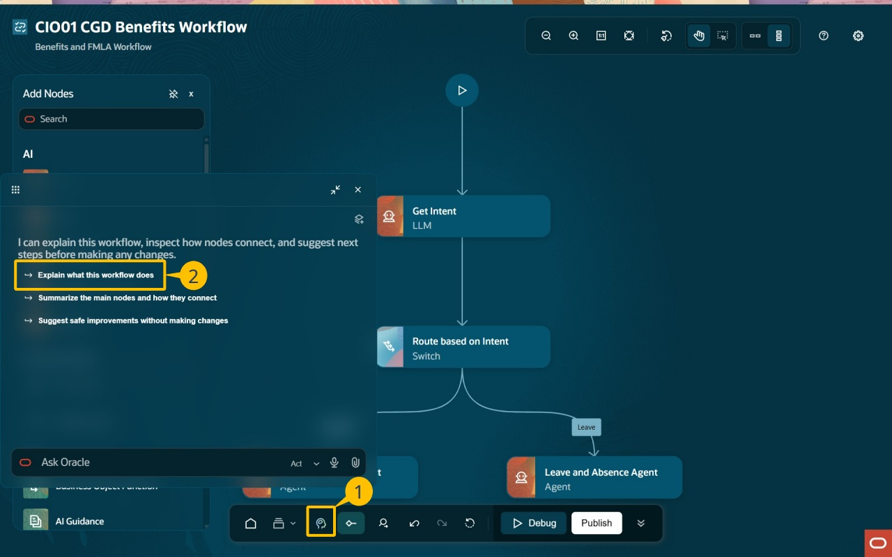

43. You can review a summary of the workflow capabilities.   You decide it would be nice for the user to receive an email of the results when they request policy info.  But, instead of manually adding that step, you decide to use the Builder Assistant.


    > (1) **Review** the description of the workflow.<br>
    > (2) Use the chat window to describe your requirements for adding an email node. Enter **Add email node and connect to Benefits Policy Advisor. Input for the email node should be the output response from Benefits Policy Advisor to send notification email with the response**.  To streamline this step, we've pre-created the chat prompt for this step. 


    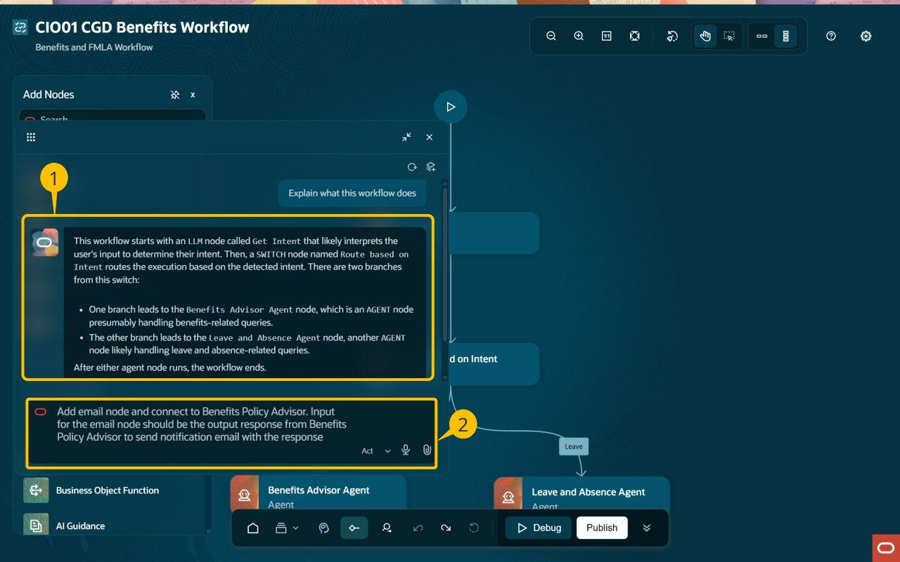
	
	**Builder Assistant Prompt**:
	```text
	<details> <summary>Prompts the Builder Assistant to Add a Node.</summary>
	<copy>
	Add email node and connect to Benefits Policy Advisor. Input for the email node should be the output response from Benefits Policy Advisor to send notification email with the response
	</copy>
	</details>
	```


44. The Builder Assistant confirms it’s actions and requests for consent to continue.


    > (1) Review the Builder Assistant’s plans.<br>
    > (2) Select **Yes** from the provided list of options to tell the Assistant to proceed with the creation of the Email workflow node. <br>


    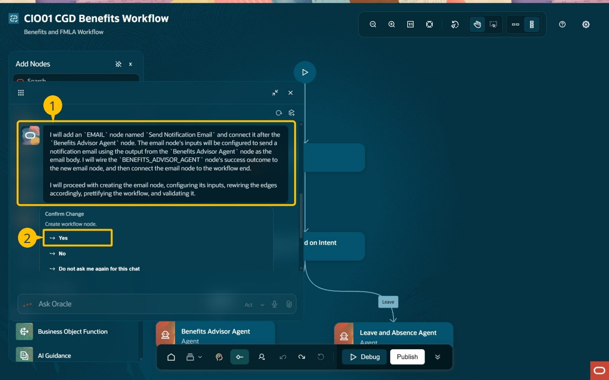

45. Two more confirmations are required.


    > (1) Select **Yes** when requested to confirm the **Modify node edges** question.


    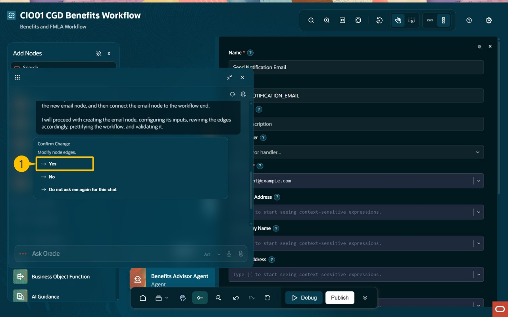

46. Final confirmation is to Prettify.

    > (1) **Review** the Builder Assistant’s summary of its actions.<br>
    > (2) Select **Yes** when requested to confirm the **Prettify workflow layout**.

    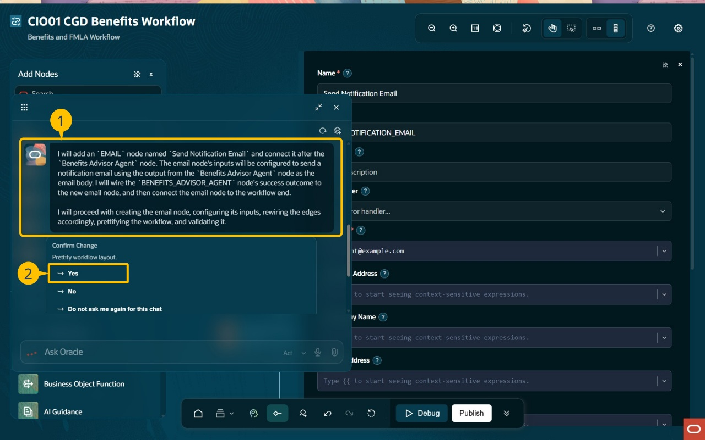


47. The Builder Assistant confirms its work.


    > (1) **Review** the Builder Assistant’s summary of its actions.<br>
    > (2) Click the **x** to close the Builder Assistant popup chat box.

    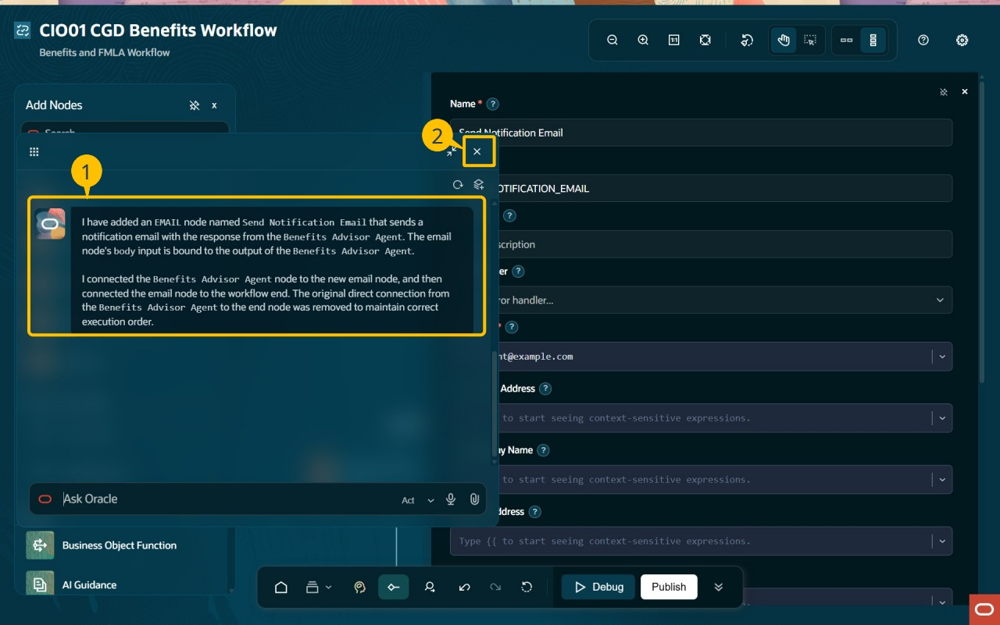

48. The Send Notification Email panel allows you to specify details of the email.


    > (1) Type your **email address** in the **Recipients** field.  Don’t worry.  We are not using or saving this email address.  It will be deleted upon conclusion of this hands-on lab.<br>
    > (2) **Scroll Down** to the **Subject** field.

    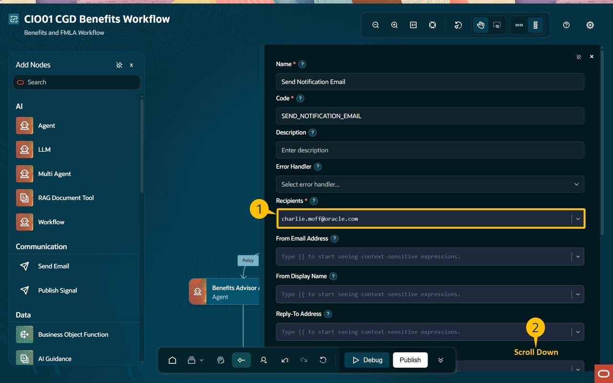

49. Add the workflow name to your email subject.


    > (1) Place your **cursor before** the word **Notification** in the **Email Subject** field.<br>
    > (2) **Click** the dropdown box at the end of the **Email Subject** field <br>
    > (3) Select **Workflow** and **Name** respectively from the resulting pop-up box. 

    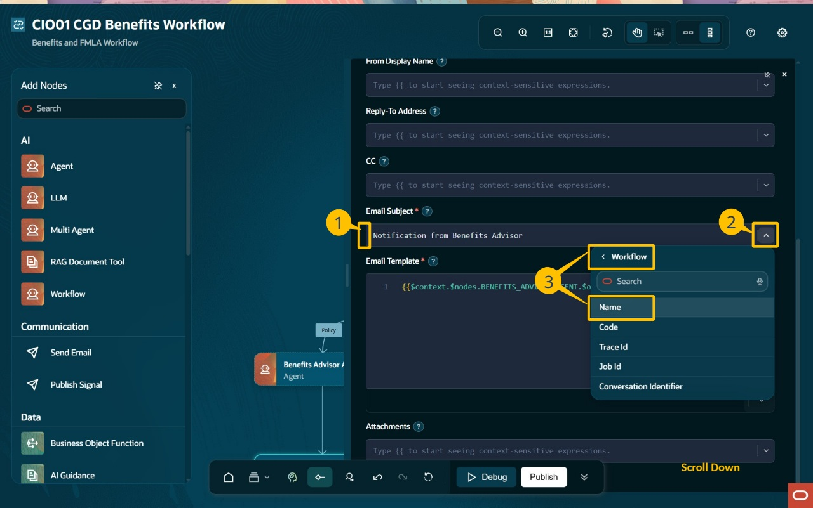

50. Confirm Email Subject change.


    > (1) Review your change to the Email Subject field.  It should look like this screenshot.<br>
    > (2) **Click** the **x** in the top right corner of the panel to close it.

    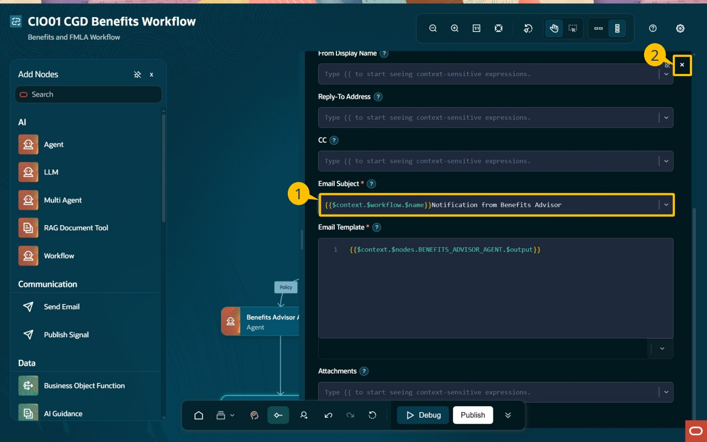

51. View your workflow and retest with Debug.


    > (1) You can see that the Builder Assistant added the Send Notification Email node as requested.  If you don’t see it, try dragging the diagram up or using the **Prettify** and **Zoom to Fit** icons as described in the next step.<br>
    > (2) Optionally **click** the **Prettify** and **Zoom to Fit** icons in the top toolbar.<br>
    > (3) Click the **Debug** button on the bottom toolbar to do one more test.

    

52. Ask about available benefits.


    > (1) Type **what are my available benefits** in the **Ask me anything** field. 

    

53. View response and the workflow route.


    > (1) Note that the response was successful. In a real implementation you’d likely have the Agent response to the chat and simultaneously send the email, possibly with different levels of details.  But we’ve simplified it here just to show you the concepts of using the **Builder Assistant** and the **Send Notification Email** node.<br>
    > (2) The Agent Workflow show that the **Send Notification Email** node was successfully completed.

    

54. View Email

    > (1) If you provided an email address, you should receive an email with the summary of your available benefits.  Again, we could configure the request to do a proper formatting of the email, but we skipped a few steps to squeeze some additional capabilities into the adventure.

    


55. Success!  

    > **You've completed this Adventure**. Please close this tab.

### Summary

AI Agent Studio is a design-time environment that empowers you to create, configure, validate, and deploy AI agents to meet your organization's needs.

With AI Agent Studio, you can easily extend preconfigured workflows, and build new workflows and agentic apps. AI Agent Studio is fully integrated into Oracle Fusion Cloud Applications, providing secure and seamless access to the knowledge stores, tools, and APIs of Fusion Applications. This integration enables agents to be deployed directly into the flow, ensuring an efficient process.

## Learn More

* [AI Agent Studio](https://docs.oracle.com/en/cloud/saas/fusion-ai/26d/aiaas/overview-of-ai-agent-studio.html)
* [AI Agents for Fusion Applications](https://www.oracle.com/applications/fusion-ai/ai-agents/)
* [AI for Fusion Applications](https://www.oracle.com/applications/fusion-ai/)
* [Oracle Documentation](http://docs.oracle.com)

## Acknowledgements

* **Author** - Stephen Chung, Principal SaaS Cloud Technologist; Sajid Saleem, Master Principal SaaS Cloud Technologist; Charlie Moff, Distinguished SaaS Cloud Technologist
* **Contributors** - The AI Adventure Team (Gus, Sajid, Casey, Stephen, Sohel, Xavier, Charlie, Ray)
* **Last Updated By/Date** - Sajid Saleem/Charlie Moff, October 2026